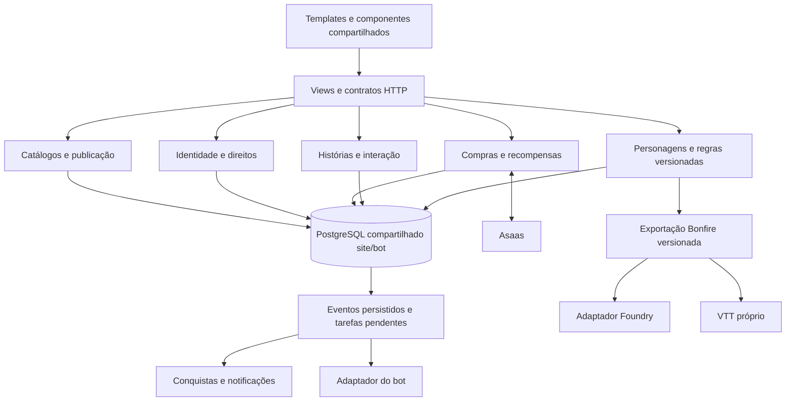
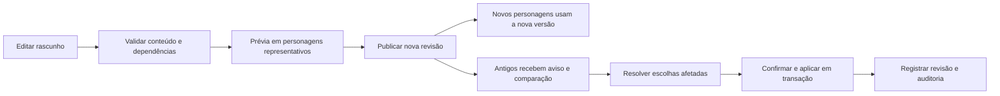

# Arquitetura de evolução do Bonfire Tales

Data: 13 de setembro de 2026. Documento de planejamento para o projeto `BonfireSite-main`.

## Prioridade vigente do PO: matriz do builder antes do release

Direcionamento de fechamento em 13/10/2026: seguir [Fechamento finito do release DEV](docs/qa/BUILDER_RELEASE_CLOSEOUT.md), etapas F1-F6. Consolidar causas da matriz, corrigir a lista residual, executar QA final e entregar commit/push dev. Nao ampliar o release com melhorias opcionais nem substituir evidencias por percentual historico.

Atualizacao de 12/10/2026: esta ordem substitui a instrucao anterior de adiar a matriz ate depois de todas as demais entregas.

1. Executar AGORA a matriz intensiva de todas as classes/subclasses vigentes e legadas suportadas. Para cada nivel suportado (1 a 20 quando aplicavel), comparar tabela E descricao da pagina da classe/subclasse com habilidades, escolhas, ASI/talentos, recursos, magias e calculos efetivamente oferecidos pelo builder. Registrar esperado, observado, versao do conteudo, evidencia, divergencia e resultado por combinacao. Nao usar o mesmo calculo do builder como unica fonte do resultado esperado.
2. Corrigir divergencias em conteudo/Markdown/tags e, somente quando necessario, no motor generico. Nao mascarar falha ajustando teste para coincidir com comportamento errado; fontes contraditorias exigem decisao pontual. Retestar combinacoes afetadas e preservar PKs, escolhas e personagens legados.
3. Depois de fechar a matriz, executar os testes finais integrados e corrigir regressoes. Reaproveitar evidencias validas de codigo/ambiente inalterados; uma suite em andamento nao justifica rodadas dedicadas apenas a polling nem precisa ser duplicada.
4. Commitar as alteracoes revisadas na branch dev e fazer push normal, sem force push. Autorizacao explicita do usuario para este marco; preservar alteracoes alheias, excluir segredos e confirmar hash local/remoto. Informar migracoes e procedimento de atualizacao.
5. O usuario atualiza a producao. Somente apos confirmacao dessa atualizacao, verificar compatibilidade da API para os dados revisados e preparar/aplicar o pacote no escopo autorizado com preview, backup e identidades de producao preservadas. Entao realizar QA publicado. Nao executar deploy, resgates ou mutacoes externas nao relacionadas por inferencia.

Cisco permanece pausado por solicitacao anterior. A prioridade de execucao agora e esta frente do site.

## Relatos e cobertura obrigatoria do builder

- [ ] Revisar incoerencias de nomenclatura entre tabelas, cards, descricoes e character builder. Relato concreto: Guerreiro apresenta ASI no nivel 4 como "Aprimoramento de Atributo ou Talento", mas nos niveis 6, 8, 12, 14, 16 e 19 como "Incremento de Atributo ou Talento". Confirmar a fonte canonica antes de escolher o nome; padronizar equivalencias em todas as classes/subclasses sem alterar regras distintas por mera semelhanca textual.
- [ ] Manter na fila os relatos anteriores de textos do Mistico sem paragrafos e linhagens ausentes do elfo. Corrigir conteudo/Markdown e tags/dados com arquitetura generica; nao introduzir condicionais por nome de classe. Preservar PKs, relacionamentos, escolhas e personagens legados.
- [ ] Como proxima entrega prioritaria, executar validacao intensiva do character builder com matriz explicita de TODAS as classes e subclasses vigentes e legadas suportadas. Cada combinacao deve ter resultado e evidencia ou bloqueio concreto, nunca aceite presumido por amostragem.
- [ ] Cobrir criacao, selecao/troca de classe e subclasse, progressao e regressao de nivel nos marcos relevantes, ASI versus talentos, pre-requisitos, habilidades, recursos, magias e espacos, escolhas obrigatorias, calculos e consistencia com tabelas/cards. Incluir multiclasse quando suportada, salvar/reabrir/editar e preservacao de personagens anteriores aos reworks.
- [ ] Exercitar o fluxo integrado real da UI e persistencia em DEV com dados de teste isolados, alem dos testes de dominio pertinentes. Conferir visualizacao/ficha/exportacao quando aplicaveis; registrar falhas por classe/subclasse e corrigir/retestar antes do aceite. Nao substituir esse marco por testes unitarios apenas, nem executar operacoes destrutivas em producao.

Durante as correcoes, manter testes focados pelo risco. A matriz intensiva acima e obrigatoria e ainda NAO tem aceite confirmado. Seguir a ordem vigente acima; publicacao em producao continua sendo um passo separado, nao implicito no push.

Esta arquitetura transforma os problemas e as funcionalidades do [READ-ME CODEX.docx](<ref/READ-ME CODEX.docx>) em um plano de implementação incremental. A direção principal é fortalecer o Bonfire como comunidade: perfis expressivos, histórias com interação, conquistas verificáveis e recompensas cosméticas, sustentados por fichas confiáveis e uma interface coerente.

A elaboração inicial se limitou a este Markdown. Em 13/09/2026, o usuário ampliou explicitamente a meta para implementar integralmente este plano. A execução e suas evidências são acompanhadas em [Evolução — progresso de implementação](docs/EVOLUCAO_PROGRESSO.md); os critérios documentais da seção 20.1 são preparatórios. As propostas abaixo, por si só, não comprovam funcionalidades implementadas, migrações aplicadas ou autorização de publicação em produção. As sugestões adicionais estão identificadas na seção 17.

Leitura sugerida: [sugestões e decisões](#17-sugestões-incorporadas-e-decisões-pendentes), [ordem de implementação](#16-sequência-de-implementação-e-validação), [relatos de QA](#18-matriz-dos-relatos-de-qa) e [rastreabilidade dos pedidos](#19-rastreabilidade-do-documento-de-origem). As seções 3 a 15 detalham a arquitetura por área.

## 1. Escopo e leitura das evidências

Foram considerados o texto do documento, suas 55 imagens incorporadas e a estrutura do código disponível neste diretório. Os identificadores `P1` a `P47` usados na rastreabilidade correspondem aos parágrafos não vazios extraídos em ordem; `imageN` corresponde ao arquivo incorporado em `word/media/` no DOCX. Não são números de página.

A análise inicial de planejamento foi estática, sem servidor, testes da aplicação, importações, operações no banco ou integrações externas. Documentação técnica pública foi consultada para confirmar possibilidades de integração; as referências estão junto às decisões pertinentes. As verificações posteriores de implementação são registradas no acompanhamento vinculado acima, com seus limites e resultados reais.

Há alterações locais anteriores a este planejamento em `bonfire/settings.py`, `home/urls.py`, `docs/agentes/regras_retagging_tags_json.md`, além de `home/vtt.py` e `home/test_vtt_integration.py` ainda não versionados. Elas fazem parte do estado observado e precisam ser preservadas na implementação futura.

### 1.1 Como interpretar os estados

| Estado | Significado |
|---|---|
| Evidência no código | Há um comportamento ou uma estrutura identificável na leitura estática. |
| Base parcial | Parte da solução existe, mas não cobre o pedido inteiro. |
| Relatado e a revalidar | O DOCX relata um problema; sua reprodução na versão em uso ainda é necessária. |
| Proposto | Desenho a implementar, sem afirmar que já está disponível. |
| Decisão de produto pendente | A estrutura pode ser planejada, mas o valor ou a regra precisa ser definido antes da ativação correspondente. |

Documentos antigos em `docs/` ajudam a entender a intenção, mas não são uma lista atual de funcionalidades concluídas. O código inspecionado prevalece para descrever a base existente; o DOCX prevalece para os objetivos desta evolução.

### 1.2 Objetivos de produto

1. Fazer a comunidade aparecer no produto, com histórias, autores, personagens públicos e motivos para retornar.
2. Corrigir problemas de criação, progressão, magias, inventário e apresentação sem perder escolhas ou patrimônio dos personagens.
3. Implementar e publicar o rework efetivo do Caçador, substituindo o conteúdo antigo na versão vigente, com versionamento e regularização assistida que também sirvam aos futuros reworks de classes e raças.
4. Unificar padrões visuais, reduzir espaços desperdiçados e manter o contexto nas interações.
5. Vender e conceder cosméticos por diferentes origens com rastreabilidade, respeitando as regras de Colab e Mestre Ouro.
6. Melhorar o bestiário e oferecer um caminho intermediário para Foundry, reaproveitável pelo VTT próprio.

Não fazem parte da primeira entrega de implementação: uma rede social genérica com mensagens privadas, um motor completo de combate, uma reescrita integral do site ou a reconstrução de todas as páginas antes de entregar valor à comunidade.

## 2. Base existente e consequências para a arquitetura

| Área | Evidência local | Consequência |
|---|---|---|
| Plataforma | `requirements.txt`: Django 6.0.4, psycopg, WhiteNoise, Waitress e openpyxl. Templates Django, CSS e JavaScript em `home/`. | Evoluir o monólito atual. Não há necessidade demonstrada de migrar para SPA ou microsserviços. |
| Organização | `home/views.py` concentra catálogos, fichas, economia, comunidade e integrações; já há módulos de domínio separados. | Extrair regras gradualmente para serviços, mantendo rotas e modelos compatíveis. |
| Regras de personagem | `home/character_engine.py`, `resource_engine.py`, `spellcasting.py`, `picks.py`, `tag_engine/`, `pathbuilder.py`. | Usar um cálculo autoritativo compartilhado entre criação, laboratório, ficha e exportação. |
| Histórico de construção | `TbPersonagemRevisao` em `home/models.py:1699` e `home/character_history.py`. | Aproveitar revisão e reversão de escolhas. Acrescentar versionamento do conteúdo: referências ao catálogo vivo não congelam regras antigas. |
| Estado de uso | `TbPersonagemEstado`, recursos e itens do personagem. | Separar a construção da ficha do consumo durante o jogo e da economia. |
| Magia de mago | Escola de foco e custo de transcrição em `home/magic_workshop.py:346` e `:561`; teste correlato em `home/test_magic_workshop.py:286`. | Revalidar o caso Mago da Guerra/Abjuração antes de substituir a regra já existente. |
| Fichas públicas | `TbPersonagem.publico`, `permissions.pode_ver_ficha`; `ficha_detail_view` exige login em `home/views.py:8721`. | Há permissão parcial para fichas públicas de usuários autenticados. Falta uma apresentação pública dedicada, com campos explicitamente permitidos. |
| Comunidade | `home/social.py` tem curtir/seguir perfis; `TbCronica` tem fluxo editorial. | Estender a base para interação em histórias. Não criar outro sistema de seguidores. |
| Conquistas | `TbConquista.criterio_json`, `TbUsuarioConquista`, `home/conquistas.py`. | O cadastro já comporta critérios; falta o motor automático e a origem auditável dos fatos. |
| Cosméticos | `TbCosmetico`, `TbUsuarioCosmetico`, `home/cosmetics.py`, arquivos de efeito e tema. | Expandir catálogo, entrega e apresentação. Não começar outro inventário de cosméticos. |
| Pagamentos | `AsaasCheckoutOrder`, criação de checkout em `home/views.py:3063`, `home/test_asaas.py`. | A venda dinâmica por API já tem base concreta; generalizar pedido e benefícios. |
| Mestre Ouro | Campos de mensalidade, data do próximo pagamento e `cobrar_mestre_ouro`. | A mudança para vitalício exige migração da regra e dos compradores históricos, além de texto e layout. |
| Economia | Carteira do personagem, `TbTransacao`, `TbPersonagemAventura`, serviços de treinamento/empréstimo. | Ampliar os registros existentes e preservar separação entre moedas. |
| Interações | `mercado_loja.js` já intercepta compras/vendas, mas troca de personagem envia formulário; `jogadores.html:36` usa `form.submit()`. | Padronizar atualizações parciais em vez de recriar todos os fluxos. |
| Regiões | Listagem já usa `TbTerritorio.imagem_url`; detalhe admite outros fallbacks. `_parse_lore_topics` cria uma Visão Geral inicial. | Investigar divergência entre dados de capa/listagem/detalhe e a geração de tópicos duplicados. |
| Admin | `home/admin.py:3755` agrupa Autenticação, Tables Bot e Tables Site; diversos ModelAdmins já têm busca e filtros. | Reorganizar navegação por tarefas. O problema não é ausência absoluta de filtros no Django. |
| Bestiário | Modelos, importadores, refinadores e motor de tags existentes. | Criar uma esteira de qualidade e enriquecimento sobre o acervo atual. |
| VTT | Exportador em `home/management/commands/export_personagem_vtt.py`; rotas novas em `home/vtt.py`. | Preservar o contrato em andamento. JSON Bonfire não equivale automaticamente a Actor/Item do Foundry. |
| Sincronização de conteúdo | `home/deploy_sync.py` distingue conteúdo e memória de usuários. | Classificar explicitamente cada tabela nova; progresso, compras e direitos não podem ser sobrescritos pelo deploy de conteúdo. |

## 3. Arquitetura proposta

### 3.1 Organização por responsabilidades

Manter o Django como aplicação central. Templates e JavaScript cuidam da apresentação; serviços de domínio validam operações; modelos e transações persistem o resultado. Integrações externas usam adaptadores com contratos explícitos.



O processamento de eventos pode começar como tarefa agendada que consome uma tabela de pendências. Uma fila externa só deve ser introduzida quando volume ou latência justificarem. Um evento persistido registra o fato ocorrido; sua entrega a cada consumidor pode ser repetida sem repetir a recompensa.

O PostgreSQL é o banco definitivo para desenvolvimento, homologação, produção e testes que persistem dados. Não introduzir caminhos alternativos nem fallback para SQLite ou MongoDB. Site e bot compartilham o banco, com responsabilidade de escrita definida por tabela/campo; compartilhar armazenamento não elimina a necessidade dos contratos de integração.

### 3.2 Limites dos módulos

| Responsabilidade | Aproveitar | Evolução proposta |
|---|---|---|
| Construção e regras | `character_engine`, `character_history`, `picks`, `point_buy`, `tag_engine`. | `rulesets/` para revisões imutáveis e resolução de conteúdo; serviço de regularização. |
| Estado da ficha | `resource_engine`, `slots`, inventário e estado. | Comandos de uso/equipamento com versão do estado e uma projeção consistente da ficha. |
| Comunidade | `social`, views e modelos de crônicas. | Serviços de publicação, reações, comentários, moderação e notificações internas. |
| Conquistas | `conquistas`. | Avaliador de critérios cadastrados, métricas e progressos derivados de eventos. |
| Comércio e benefícios | `cosmetics`, `market_services`, pedidos Asaas e permissões. | Ofertas, direitos de acesso, resgates e adaptação do checkout existente. |
| Conteúdo | Importadores, admin e `deploy_sync`. | Publicação de revisões, validação prévia, referências estáveis e relatórios de impacto. |
| Integrações | Exportador VTT, tabelas e vínculo Discord. | Adaptadores de bot/Foundry, sem inserir dependência do Foundry no cálculo de personagem. |

Os nomes de módulos novos são orientativos. A extração deve acontecer ao implementar cada fatia funcional; mover milhares de linhas sem mudar comportamento não é um pré-requisito para todas as entregas. Preservar `app_label`, tabelas e históricos de migração na primeira reorganização.

### 3.3 Regras transversais

- Classes e subclasses seguem um contrato comum de conteúdo versionado: texto formatado no Markdown do registro; referências e cards derivados das identidades dos dados; mecânicas declaradas em tags avaliadas pelo interpretador compartilhado. A publicação vincula explicitamente cada classe a uma revisão imutável. Nenhum renderer, endpoint ou controlador de publicação deve depender do slug, checksum ou número de subclasses de uma classe específica. A alteração de conteúdo usa operações estruturadas e auditadas do banco/API/admin, com prévia, versão esperada, backup e aplicação transacional; scripts de conteúdo por classe não são o produto de publicação. Fichas existentes conservam a revisão fixada até regularização individual. A migração gradual dos consumidores legados exige regressão de página, criador e ficha antes de retirar compatibilidade.
- O servidor decide permissões, custos, limites, elegibilidade e recompensas. O navegador pode antecipar validações para orientar o usuário.
- Operações de patrimônio usam transações e unicidade. Débito, crédito, desbloqueio e registro da operação precisam formar uma unidade lógica.
- Fatos que alimentam o bot ou conquistas são gravados junto da alteração de negócio. `on_commit` pode acordar o processador, mas não substitui uma pendência persistida: uma queda do processo não pode perder a entrega. Ver [transações do Django](https://docs.djangoproject.com/en/6.0/topics/db/transactions/).
- Identificadores estáveis representam classes, criaturas, magias, ofertas e regras. Nomes exibidos e traduções podem mudar sem romper referências.
- Fluxos de leitura pública não sincronizam nem corrigem fichas no banco. Há chamadas de sincronização na view operacional atual; a projeção pública deve ser pura.
- Cada recurso pode ser liberado por configuração independente, permitindo reversão de interface sem desfazer patrimônio ou regras publicadas.

### 3.4 Entrega e recuperação dos eventos

Persistir o evento e suas entregas locais na mesma transação da operação de negócio. A primeira funcionalidade que produz um fato relevante já registra sua identidade canônica; a ativação posterior de conquistas ou créditos não deve depender de reconstruir interações que nunca foram guardadas.

| Elemento | Contrato operacional proposto |
|---|---|
| Evento | ID estável, origem/chave externa única, tipo e versão do payload, agregado e sua revisão, data do fato e da ingestão. Evitar dados pessoais desnecessários. |
| Entrega | Unicidade por evento/consumidor, estado pendente/em processamento/concluído/em revisão, tentativas, próxima tentativa e erro resumido. Cada consumidor progride independentemente. |
| Reserva de processamento | Reserva atômica no PostgreSQL com prazo e token de posse; trabalhadores concorrentes não assumem a mesma entrega válida. Reserva expirada pode ser retomada. A confirmação exige o token vigente. |
| Efeito local | Alteração de métrica, concessão e conclusão da entrega na mesma transação, com chave única de aplicação. Reexecução consulta o efeito já registrado. |
| Efeito externo | Chave estável da operação no adaptador e reconciliação após timeout. Não manter transação/bloqueio de carteira aberto durante chamada de rede; sucesso remoto seguido de queda local continua recuperável. |
| Falha | Novas tentativas com intervalo crescente e limite configurável; ao esgotar, manter a entrega em revisão, alertar e permitir retomada auditada com a mesma identidade. |
| Ordenação | Quando a regra depende de sequência, processar revisões na ordem do agregado e detectar lacunas; falha em um agregado não bloqueia todos os demais. Consumidores sem essa dependência deduplicam pela identidade do fato. |
| Histórico | Preservar evidências e chaves de deduplicação pelo período necessário aos direitos, estornos e reprocessamentos que sustentam. A política de arquivamento deve manter essas garantias; limpeza de logs não apaga a memória de concessões. |

Aceite de infraestrutura: dois trabalhadores concorrentes, queda antes/depois do efeito, expiração da reserva, evento duplicado, eventos fora de ordem e indisponibilidade externa não perdem fatos nem repetem concessões. Medir idade da entrega mais antiga, falhas e itens em revisão; o painel operacional identifica a operação sem expor credenciais.

## 4. Fichas seguras diante de reworks

### 4.1 Problema a resolver

Um histórico que salva atributos, escolhas e IDs permite desfazer parte de um level-up. Ele não protege um personagem se a habilidade apontada pelo ID tiver sido sobrescrita, removida ou reinterpretada pelo motor. Atualizar uma classe no mesmo registro pode modificar silenciosamente personagens antigos quando `derive()` consultar esse conteúdo.

### 4.2 Modelo de versões

| Estrutura proposta | Conteúdo e invariantes |
|---|---|
| Identidade de conteúdo | ID/slug permanente da classe, raça, linhagem, essência, habilidade, opção ou magia. |
| Revisão de conteúdo | Identidade, versão, payload normalizado, dependências, checksum, autor e estado editorial. Revisão publicada é imutável. |
| Conjunto de regras | Manifesto de revisões compatíveis, versão do vocabulário de tags e contrato do motor. Evita misturar acidentalmente partes de reworks diferentes. |
| Vínculo do personagem | Conjunto de regras usado, revisão da construção e estado de regularização. `TbPersonagemRevisao` registra também esses vínculos. |
| Plano de regularização | Revisões de origem/destino, diferenças, escolhas mantidas, escolhas a refazer, efeitos derivados e justificativa. |
| Caso de revisão staff | Solicitação de reset ou exceção, responsável, motivo, prévia e registro da aplicação. |

Criar um resolvedor pelo qual os motores obtenham conteúdo na versão do personagem. FKs atuais continuam representando identidade; o cálculo não deve voltar ao registro mutável quando houver revisão fixada. Proteger revisões em uso contra exclusão e preservar aliases de conteúdo renomeado.

Congelar JSON sem congelar seu significado também é insuficiente. O conjunto de regras deve declarar a versão semântica do avaliador. Mudanças incompatíveis no motor exigem adaptador para versões suportadas ou uma migração explícita, com exemplos de cálculo antes/depois.

### 4.3 Publicação e regularização



Personagens antigos continuam legíveis na versão anterior. O jogador vê o que muda e regulariza as escolhas afetadas; uma política de prazo para regularização pode ser configurada depois. A eventual restrição a novos level-ups deve ser explícita e não bloquear a leitura da ficha.

Classes e subclasses compartilham o mesmo contrato de publicação e apresentação: textos estruturados ficam no Markdown dos registros, cards e referências nas relações e tags do catálogo, progressão e recursos nos dados versionados. A página e o motor interpretam esses contratos sem ramos por slug ou nomes de habilidade. Uma revisão nova é criada por operações estruturadas no banco/admin/API, com prévia, validação, auditoria e ativação separada; revisões publicadas e fichas vinculadas permanecem imutáveis. Código novo só amplia uma capacidade comum demonstrada em mais de uma classe. Scripts de conteúdo específicos de classe não são o produto final de publicação; migrações de schema são uma operação distinta.

Regularização ordinária preserva dono, identidade do personagem, aventuras, inventário, moedas, concessões e personalização. PV máximo, usos máximos e magias são recalculados; o consumo atual é conciliado por regra documentada para impedir cura, reposição ou ganho de recursos por alternar versões.

Reset completo é outro fluxo: pedido à staff e prévia do que será reconstruído. Não tratar reset como apagar personagem e criar outro, pois isso perderia vínculos e poderia duplicar conquistas. A política de mudança de classe/raça e de patrimônio preservado deve ficar no tipo de reset, com auditoria.

### 4.4 Migração inicial

1. Inventariar conteúdo e personagens afetados sem alterar os registros.
2. Criar uma versão de base com o catálogo realmente disponível e vincular os personagens existentes a ela.
3. Se algum rework já tiver sobrescrito conteúdo antigo, marcar que a reconstrução histórica depende de fontes anteriores. Não inventar uma versão que não pode ser comprovada.
4. Habilitar o resolvedor de versões e comparar resultados com a base atual em personagens representativos.
5. Só então publicar o primeiro rework pela nova esteira.
6. Adaptar imports, edição inline, admin, fixtures e `deploy_sync` para que não atualizem revisões publicadas em uso.

Uma reversão de regularização restaura a construção compatível, sem reverter compras ou aventuras posteriores. Caso o estado atual torne a reversão incompatível, apresentar conflito à staff em vez de repor um snapshot inteiro do personagem.

### 4.5 Rework efetivo do Caçador

**Entrega obrigatória: implementar o conteúdo e as mecânicas do novo Caçador e torná-lo a versão vigente da classe.** O versionamento é uma dependência dessa entrega, não seu resultado final. A expressão “piloto” usada anteriormente significava a primeira classe a utilizar a infraestrutura; não reduz o escopo a uma demonstração ou à preparação para um rework futuro.

O material em [Caçador reworkado](<ref/Classes Reworkadas/Caçador in Bonfire Tales RPG _ World Anvil.html>) deve orientar a especificação do Caçador. A leitura identifica contratos que exigem mais que trocar descrições: escolha permanente de Inteligência ou Sabedoria na criação; conjuração e preparação por tabela; Marca do Caçador sempre preparada fora do limite comum; Dado de Caçador por patamares; Segredos, Linhas, graus, Ordens e recursos próprios.

A versão inicial do piloto deve representar explicitamente a escolha de atributo, níveis de classe, progressão do dado, limite/preparação de Segredos, Linha Mestra e dependências das Ordens. Conferir multiclasse, companheiros e mudanças de opções. Reaproveitar `picks`, recursos e tags suportadas; ampliar o vocabulário de forma validada quando faltar uma operação real.

Contratos extraídos para conferência: dado d6/d8/d10/d12 nos níveis 1/5/11/17; Segredos em três Linhas e graus liberados nos níveis 2/5/9/13; pontos de Segredo iguais ao nível de Caçador e recuperação no descanso longo; oito Ordens a partir do nível 3. Estilo de Luta aparece no nível 2 desse rework, enquanto `image20` relata sua ausência no nível 1. Registrar a divergência de versão antes de corrigir. A regra da Marca também exige revisão editorial: metade do nível arredondada para baixo para dissipação resulta em zero no nível 1; não inventar um mínimo.

Magias pagas ou transcritas exigem tratamento próprio na regularização: preservar aquisição e procedência mesmo quando o novo conjunto de regras suspender sua elegibilidade. O restaurador atual reconstrói a coleção de magias; não reutilizá-lo cegamente como migração de rework.

Aceite: uma ficha de Caçador antiga permanece com o mesmo resultado após a publicação; uma nova usa o rework; a regularização apresenta diferenças e não duplica escolhas, inventário, aventuras ou recompensas.

### 4.6 Substituição das habilidades antigas pelas novas

A entrega cobre a progressão completa dos níveis 1 a 20, as oito Ordens e suas progressões, Segredos de todas as Linhas/graus e os recursos, opções, magias e companheiros exigidos pela referência. Não encerrar o trabalho após implementar apenas INT/SAB, Marca do Caçador e pontos de Segredo.

| Etapa | Trabalho de implementação previsto | Entrega verificável |
|---|---|---|
| Inventário e comparação | Extrair a referência do rework e comparar com habilidades, subclasses, recursos, opções e tags atualmente cadastrados. Conferir os documentos de regras citados em `docs/`. | Matriz por habilidade: identidade antiga, nível/origem, destino novo, mudança de efeito e ação de migração. |
| Conteúdo novo | Cadastrar as descrições, tabelas, habilidades, Ordens, Segredos, requisitos e referências do rework na revisão nova. | Cada entrada da referência aparece no conteúdo novo ou tem divergência editorial explicitamente resolvida. |
| Substituições e retiradas | Marcar cada entrada antiga como mantida, revisada, substituída, dividida, consolidada ou retirada. | A versão vigente não concede habilidades removidas nem mantém o efeito antigo junto do substituto. |
| Implementação mecânica | Implementar tags, escolhas, recursos, preparação, progressão e operações que o site deve calcular; ampliar o motor quando faltar suporte. | Efeitos e limites corretos no criador, laboratório, level-up e ficha, não somente descrição atualizada. |
| Publicação | Ativar o novo conjunto como Caçador vigente e atualizar catálogo, seletores e conteúdo distribuído. | Novos personagens recebem o rework; a consulta padrão da classe mostra a versão nova. |
| Regularização | Mapear as escolhas antigas para as novas, solicitar escolhas sem equivalência e aplicar o plano de migração. | Ficha regularizada deixa de usar os efeitos substituídos e passa a usar os novos, mantendo patrimônio e histórico. |

Preservar a identidade estável da classe. Habilidades antigas continuam disponíveis somente onde forem necessárias para resolver fichas/históricos na versão anterior; elas não permanecem ativas na nova versão por terem sido conservadas no banco. Não usar correspondência de nome como único critério de migração e não aplicar exclusão em cascata para substituir o catálogo.

Consultar especialmente `docs/criador-personagem/dicionario-tags.md`, `vocabulario-tags-json.md`, `novos-verbos-pendentes.md` e `bestiario-e-summon.md`. Esses documentos já mencionam recursos e necessidades do Caçador, incluindo Marca persistente, atributo INT/SAB e possível duplicação de Conjuração nos níveis 1/2. São pistas para conferir no estado atual, não prova de que o rework esteja implementado nem de que as pendências históricas ainda estejam abertas.

Para regras executadas durante a mesa, apresentar texto completo e dados corretos para exportação, distinguindo automação disponível de operação manual. Essa distinção não pode justificar deixar sem implementação cálculos e escolhas que pertencem ao site, nem manter a habilidade antiga como substituto temporário sem uma pendência explícita.

### 4.7 Critérios para considerar o rework concluído

- Comparação completa da referência com a implementação: níveis 1–20, oito Ordens, Linhas/graus de Segredos, habilidades e dependências, sem omissões silenciosas.
- Casos nos marcos de progressão verificam atributo INT/SAB, dado de Caçador, slots/preparação, Marca, custos/recuperação, escolhas automáticas e opcionais, companheiros e multiclasse.
- Catálogo, criador, laboratório, level-up e ficha consultam a mesma versão nova; escolhas e efeitos antigos substituídos não aparecem nessa versão.
- Publicar não modifica fichas ainda legadas; regularizar modifica efetivamente suas habilidades e cálculos para o rework, sem acumular os benefícios das duas versões.
- As alterações de conteúdo entram no fluxo de distribuição do projeto e os exportadores preservam identificação da versão, referências e avisos pertinentes.
- O relatório final separa infraestrutura de versionamento concluída, conteúdo/mecânicas do Caçador concluídos e regularização disponível. Concluir somente a primeira parte não encerra esta entrega.

## 5. Correções e interação da ficha

### 5.1 Contrato único de construção

Criador, laboratório e level-up precisam consultar o mesmo serviço de validação e derivação. O laboratório continua sendo simulação; só uma ação explícita de salvar/aplicar produz alteração persistente.

Separar três camadas: atributos comprados na base, bônus de fontes escolhidas e valores finais derivados. O teto de point buy aplica-se à base; bônus raciais, talentos e ASIs têm origem e regras próprias. Ao retirar uma escolha, remover apenas os efeitos e subescolhas que dependem dela, sem deixar atributos ou proficiências órfãos.

Toda resposta de prévia carrega a versão/identificador da solicitação. O cliente ignora respostas antigas e mantém o último resultado válido em erro. Um erro de rede ou cálculo não pode eliminar o orçamento e liberar controles sem limite. Na aplicação definitiva, o servidor recalcula e rejeita a construção inválida, inclusive se o JavaScript for burlado.

### 5.2 Busca de magias e separação de conceitos

Criar um seletor pesquisável compartilhado entre criação, level-up, preparação e oficina: busca por nome PT/EN com normalização de acentos, filtros pertinentes, contagem de selecionadas, estado sem resultados e navegação por teclado. Filtrar a lista não remove seleções que ficaram invisíveis; um resumo mantém essas escolhas acessíveis.

Subclasse, escola de foco, lista de acesso, atributo de conjuração e motivo de desconto são campos distintos. Mago da Guerra com foco em Abjuração deve continuar sendo Mago da Guerra. Apresentar na transcrição o custo base, o benefício aplicado e a origem da regra; prévia e cobrança usam a mesma função.

Revalidar o relato de Clérigo no nível 18 com três espaços de 5º círculo, conforme a conversa incorporada ao DOCX. Comparar a tabela Bonfire e a função de slots antes de alterar dados; não importar silenciosamente uma regra externa como se fosse a regra do servidor.

### 5.3 Atualizações parciais sem perder contexto

Adotar um pequeno cliente HTTP compartilhado sobre `fetch`, compatível com os módulos JavaScript existentes. Não é necessário adicionar um framework para resolver esses fluxos.

| Interação | Resposta esperada |
|---|---|
| Consumir/recuperar slot ou recurso | Atualizar contador e dependências; conservar aba, foco e rolagem. |
| Equipar ou sintonizar | Atualizar inventário, slots de equipamento, atributos, CA, PV, perícias, ataques e recursos afetados com a mesma revisão de estado. |
| Trocar personagem no mercado | Recarregar carteira, elegibilidade, inventário e contexto do personagem escolhido; manter busca, ordenação e item selecionado quando válidos. |
| Filtrar jogadores/catálogos | Atualizar resultados e URL; navegação Voltar/Avançar restaura filtros e seleção. |
| Enviar comando inválido | Mostrar erro junto da ação e conservar o último estado válido; sem fingir que houve sucesso. |

Mutações enviam personagem explícito, versão esperada do estado e chave da operação quando houver risco de repetição. Respostas incluem `operation_id`, versão resultante, campos atualizados e mensagem apresentável. Conflitos concorrentes retornam um erro identificável e o estado atual para reconciliação.

A sessão pode lembrar o último personagem, mas não deve ser a única fonte de identidade de uma compra: duas abas podem estar operando personagens diferentes. Cada comando valida o dono e o personagem informado.

Formulários HTML continuam funcionando como alternativa. Quando uma navegação completa for necessária, preservar `tab`, filtros e retorno em uma URL interna validada. Nunca reenviar automaticamente um POST de compra após um timeout sem consultar o resultado da operação.

### 5.4 Organização visual da ficha

Usar os prints Roll20 como referência de densidade e posição de informação. Atributos e perícias ficam em uma coluna compacta; defesa, vida, ataques e recursos de uso frequente ficam juntos; características extensas usam expansão sob demanda.

Na área de magias, agrupar por círculo com contadores pequenos próximos das listas, revelar descrição na própria magia e recolher círculos sem conteúdo quando isso fizer sentido. Evitar dez cartões vazios ocupando a tela de um personagem com poucas magias. Recursos usam linhas ou pequenos blocos proporcionais à quantidade real, com controles legíveis no toque.

Exibir termos de jogo ao jogador. Tags, diagnósticos e IDs técnicos ficam em uma visão de inspeção para staff, não ocupando o corpo principal do catálogo ou da ficha.

### 5.5 Pré-requisitos por dados estruturados

Em `home/templates/home/pages/talentos.html:341`, os filtros ainda dividem `pre_requisito` por vírgula e “ou”; há também interpretação textual de elegibilidade em `home/views.py`. Trocar apenas os chips visuais deixaria decisões diferentes entre catálogo e criação.

Criar uma projeção de requisitos a partir das tags e do parser existente: atributos mínimos, nível total/de classe, identidade de classe/raça, proficiências, escolhas possuídas e combinações E/OU. O mesmo contrato oferece três resultados: elegibilidade, motivos legíveis e facetas para busca. Filtrar “exige conjuração” é diferente de “meu personagem atende”; manter essas duas funções claras.

Inventariar requisitos legados, comparar interpretação atual e estruturada e resolver ambiguidades antes de migrar. Texto permanece explicação editorial, sem gerar regra nova por pontuação. Se uma regra necessária não for interpretável, apresentar pendência de revisão e impedir uma conclusão falsamente válida; não ocultar o conteúdo do catálogo. Os testes devem cobrir equivalência entre catálogo, prévia e aplicação, inclusive condições E/OU e mudança de requisitos por versão.

## 6. Sistema visual e reorganização das páginas

### 6.1 Direção de design

A identidade deve vir de tipografia consistente, imagens bem selecionadas, hierarquia clara e detalhes discretos associados ao mundo. Preservar o que foi aprovado em raças, regras e punições, tornando-se mestre, jornal, crônicas e mapa. A padronização permite exceções de composição para atlas, ficha e mercado, mas não escalas arbitrárias de fonte ou controles diferentes para a mesma ação.

Criar tokens compartilhados de cor, tipografia, espaçamento, largura, borda, foco e estados. Ponto de partida para validar visualmente: texto principal entre 14 e 16 px; texto auxiliar normalmente a partir de 12 px; títulos comuns entre 24 e 32 px; escala de espaçamento 4/8/12/16/24/32 px. Reservar títulos muito grandes à abertura da home. São diretrizes propostas, não medidas já aprovadas.

Usar Cinzel de forma contida em títulos e Inter na leitura e nos controles, aproveitando as fontes já presentes. Fundos e superfícies devem separar conteúdo sem depender de grandes blocos cinzentos. Cores de regiões e cosméticos são acentos; não devem comprometer leitura, estado de seleção ou mensagens de erro.

### 6.2 Componentes compartilhados

- Estrutura da página com cabeçalho, título, ação principal e área de conteúdo.
- Barra de busca e filtros, filtros ativos, ordenação e estado sem resultados.
- Lista com painel de detalhe, seleção persistente e versão mobile.
- Seletor pesquisável com grupos e resumo de escolhas.
- Abas com URL, teclado e painéis realmente exclusivos quando apresentadas como abas.
- Contador de recurso, carteira, cartão de item, cartão de personagem e bloco de autor.
- Prévia de cosmético, modal, confirmação contextual, erro e carregamento.
- Imagem com proporção e ponto focal configuráveis, placeholder e fallback centralizados.

Consolidar CSS por componente e extrair gradualmente estilos/scripts inline. O `base.html` usa Tailwind via CDN e bibliotecas remotas sem versão explícita em alguns casos. Planejar CSS estático compilado e dependências fixadas, sem combinar isso com migração automática de versão principal. O próprio [Tailwind documenta o Play CDN como ferramenta de desenvolvimento](https://tailwindcss.com/docs/installation/play-cdn).

### 6.3 Tratamento por área

| Área | Mudança proposta | Aceite visual e funcional |
|---|---|---|
| Classes | Lista e detalhe mais compactos, identidade visual de classe, progressão legível e resumo útil. | Seleção clara; conteúdo não repetido em cartões gigantes; mesma tipografia dos outros catálogos. |
| Raças | Preservar composição aprovada; ponto focal por imagem e variantes de recorte. | Rostos e elementos principais visíveis nas larguras de referência. |
| Antecedentes | Resumo das regras básicas recolhível, título proporcional e detalhes sem repetição de citação/resumo. | Lista e primeira informação útil aparecem cedo; seleção não exige rolagem excessiva. |
| Talentos | Preservar simplicidade; filtros semânticos por tags. | Não surgem filtros duplicados por pontuação ou trechos de texto legacy. |
| Opções | Reutilizar composição de lista/detalhe e requisitos estruturados. | Grupos compreensíveis; seleção e leitura de pré-requisitos consistentes. |
| Magias | Busca/filtros padronizados, escola como detalhe visual discreto, descrição organizada. | Importação por Excel só na área de administração; edição inline não oferece importação em massa. |
| Jogadores | Cards de mesma família visual, filtros e paginação parciais. | Troca de filtro sem recarregar a página inteira e sem perder URL compartilhável. |
| Bestiário | Statblock hierarquizado, imagem e seções claras de ações/reações/recursos. | Dados normalizados, sem restos de marcadores internos no texto público. |
| Condições e glossário | Busca comum, grupos e resumos funcionais ligados ao detalhe. | Encontrar uma condição oculta as não correspondentes e também respeita a busca nas regras. |
| Mercados | Mesma estrutura de balcão, busca, item, preço, carteira e retorno de compra. | Comunidade e loja oficial compartilham linguagem visual e contexto do personagem. |
| Treinamentos | Busca digitável; grupos Idiomas, Ferramentas, Instrumentos e Jogos. | Não apresenta empréstimos abaixo como se fizessem parte da aba de treinamento. |
| Mestre Ouro/mercado de mestre | Benefício vitalício explícito, saldo/recompensas em blocos claros. | Nenhuma indicação de renovação mensal após a mudança de regra. |
| Organizações/mundo | Tipografia do catálogo, metadados úteis e referências internas resolvidas. | Não mostrar `[]`, JSON serializado ou badges vazios; relações ausentes têm estado vazio apropriado. |
| Regiões | Manter catálogo visual solicitado; capa real por região/território e navegação discreta. | Reino Auraliano usa a capa existente; uma única Visão Geral por conteúdo. |
| Mapa | Preservar experiência aprovada; integrar apenas tokens e navegação necessários. | Nenhuma regressão de desenho, camadas, filtros ou geometria. |
| Jornal/crônicas | Preservar leitura editorial; acrescentar interação e autoria. | Texto continua sendo o centro da página; ações sociais não poluem o artigo. |
| Home | Explicar a proposta, mostrar comunidade ativa e facilitar entrada. | Visitante entende o que é Bonfire, como jogar e onde explorar sem depender só de um banner. |

### 6.4 Regiões e conteúdo estruturado

Criar uma política única de resolução de capa usada em cards, detalhes e prévias: imagem explícita da entidade, fallback editorial configurado, depois placeholder. Se houver mais de uma imagem candidata de região dentro de um território, não escolher arbitrariamente a primeira; registrar uma capa de território ou uma referência editorial explícita.

Normalizar o parser de tópicos para não adicionar uma Visão Geral vazia antes de um cabeçalho homônimo. Gerar slugs únicos, manter links antigos quando possível e separar correção de parser da limpeza de conteúdo realmente duplicado.

O template de organizações já sabe omitir arrays vazios reais, mas uma string `"[]"` pode escapar desse tratamento. Normalizar o formato na entrada e no payload de apresentação; relacionamentos devem chegar como listas tipadas. Corrigir fontes e serializadores, além do sintoma visual.

### 6.5 Home, responsividade e publicidade

A home deve combinar apresentação curta, ações Entrar no Discord/Criar personagem, como funciona em poucos passos, histórias recentes aprovadas, exploração de Cinéria e benefícios da comunidade. Para quem já está logado, incluir atalhos para personagens e atividades pertinentes. Não exibir métricas fictícias.

As laterais para anúncios são requisito do DOCX. Reservar posições estáveis na estrutura desktop; definir comportamento equivalente em telas pequenas sem esmagar o conteúdo. O código já contém condicionais e componentes de AdSense: isso não comprova ativação/configuração em produção. A implementação visual deve ser validada com espaços de anúncio simulados, sem depender de publicar anúncios agora.

Verificar pelo menos larguras de 360, 768, 1280 e 1920 px, zoom de 200%, teclado e preferência por movimento reduzido. Essas verificações são futuras. Densidade compacta não deve significar texto ilegível, controles minúsculos ou dependência exclusiva de hover.

## 7. Comunidade e histórias

### 7.1 Publicação e interação

Usar `TbCronica` como base inicial para contos e crônicas da comunidade. Se a distinção editorial for necessária, acrescentar tipo de publicação; não duplicar todo o fluxo de conteúdo. Jornal continua com seu papel editorial próprio.

Adicionar reações em histórias, comentários, denúncias e notificações internas. A primeira versão pode usar apenas curtir e comentários com um nível de respostas. Curtir/seguir perfis existentes continuam independentes do placar de uma história.

| Estrutura | Contrato proposto |
|---|---|
| Revisão de crônica | Rascunho, versão submetida e versão pública separadas. Uma edição substancial de conteúdo aprovado não substitui silenciosamente a versão publicada. |
| Curtida de crônica | Uma por usuário e crônica; inclusão/remoção idempotente. Sem contar a curtida do próprio autor para recompensa. |
| Comentário | Autor, crônica, resposta opcional, texto, datas, estado e revisão de edição. Apenas conteúdo publicável é exposto. |
| Denúncia/moderação | Alvo, motivo, decisão, responsável e datas. Comentário oculto mantém trilha para revisão. |
| Notificação | Evento, destinatário, tipo, link e leitura; deduplicação por evento/destinatário. |

Endpoints de curtida/favorito devem receber o estado desejado, como `curtido=true`, e devolver estado/contagem oficiais. Repetir um comando de alternância poderia desfazer a primeira tentativa; a unicidade da linha sozinha não resolve isso. Comentários e publicações usam renderização sanitizada, limites de envio e permissões por objeto.

Manter a versão aprovada visível enquanto uma alteração aguarda revisão. O código atual permite editar uma crônica aprovada sem necessariamente reiniciar aprovação; isso precisa ser resolvido antes de atrelar publicação a remuneração.

Começar com feed cronológico, publicações de autores seguidos e destaques editoriais. Ranking por curtidas pode existir como filtro; não deve dominar toda a descoberta e impedir autores novos de aparecer.

### 7.2 Créditos por contribuição

Propor uma moeda social de conta, com nome editorial ainda a definir. Ela recompensa contribuição verificada, sem equivalência com dinheiro e sem conversão automática de R$ em progressão. A política deve cobrir tanto constância de autoria quanto reconhecimento por leitores.

Aprovação/publicação de uma história elegível pode gerar uma parcela fixa. Marcos de leitores únicos elegíveis podem gerar outra parcela, limitada por história e período. Não pagar indefinidamente por cada clique: autocurtidas, remover/recolocar curtida e republicação do mesmo texto não podem gerar créditos adicionais.

| Parâmetro configurável | Proposta de comportamento |
|---|---|
| Elegibilidade da história | Conteúdo aprovado, autor elegível e revisão publicada identificável. |
| Parcela por autoria | Crédito por primeira publicação elegível; revisões não renovam essa parcela. |
| Parcela por reconhecimento | Marcos de leitores únicos após uma janela de consolidação. |
| Limites | Tetos por história, autor e período, com regra versionada. |
| Moderação posterior | Suspensão de valores pendentes; estorno auditado quando necessário, sem apagar histórico. |
| Retroatividade | Campanha separada e simulável; não converter curtidas antigas automaticamente. |

Os valores, marcos, janelas e limites não foram definidos no DOCX. Devem ficar em configuração ainda inativa até o PO fechar a tabela. A modelagem e a interface administrativa podem avançar antes disso.

### 7.3 Resgate por aventura e recompensa

Oferecer o resgate solicitado de **uma aventura e uma recompensa** como produto específico da moeda social. Ao resgatar, o usuário escolhe um personagem elegível e vê exatamente o benefício e seu custo. Débito e entrega usam uma mesma operação auditável e não podem ocorrer duas vezes.

Registrar no ledger de aventuras a origem `recompensa_comunidade` ou equivalente, sem inventar uma mesa jogada, um mestre ou uma missão. O benefício pode contar para progressão conforme decisão do PO, mas deve ser distinguido das aventuras efetivamente jogadas usadas por conquistas. Definir qual tabela de recompensa em ouro é aplicável e capturar seus valores na operação.

Proposta para lançamento: limite por período e personagem, validação de elegibilidade no servidor e histórico visível de resgates. Limites e valor exato da recompensa ficam pendentes de produto. Estornos geram lançamentos compensatórios; se o benefício já produziu efeitos subsequentes incompatíveis, abrir revisão administrativa, sem remover arbitrariamente níveis ou itens adquiridos depois.

## 8. Conquistas automáticas e verificáveis

### 8.1 Cadastro sem código por conquista

É viável cadastrar muitas conquistas sem escrever uma função Python para cada uma. O código implementa um conjunto pequeno de métricas, filtros e operadores seguros; o admin combina esses elementos em definições versionadas. Um tipo de fato inteiramente novo ainda pode exigir desenvolvimento de uma métrica ou adaptador.

Evoluir `TbConquista.criterio_json` com um schema validado e um formulário assistido. Exemplo ilustrativo da estrutura proposta, ainda não aceito pelo motor atual:

```json
{
  "schema_version": 1,
  "metric": "adventures_played",
  "scope": "account",
  "aggregate": "sum",
  "filters": {"valid": true, "origin": "played_session"},
  "operator": "gte",
  "target": 100
}
```

Uma definição informa se a condição depende de estado atual, marco histórico ou evento. Isso evita remover uma conquista de riqueza já alcançada só porque o jogador gastou ouro, ou manter um prêmio originado de um lançamento fraudulento revertido.

### 8.2 Catálogo inicial pedido pelo PO

| Família | Métrica e fonte | Recompensa sugerida |
|---|---|---|
| Mais de 100/200/300 aventuras | Soma de aventuras jogadas válidas de todos os personagens da conta, com deduplicação site/bot; configurar comparação estrita ou inclusiva após esclarecer os limiares com o PO. | Títulos e detalhes de perfil progressivos. |
| Primeiro personagem/Obsidiana | Primeira criação real concluída; não simulação no laboratório. | Título de início e moldura estática de rank. |
| Ametista, Topázio, Esmeralda, Âmbar, Rubi, Ascendido | Maior rank validamente atingido por um personagem da conta. | Moldura e título de cada marco. |
| Início de cada classe | Criação real no nível 1 com a classe correspondente. | Detalhe de perfil específico da classe. |
| Nível 20 sem multiclasse, por classe | Um personagem atinge nível 20 apenas naquela classe; consultar histórico de construção para a interpretação adotada. | Título e cosmético de classe mais elaborado. |
| Primeira compra de item na loja | Primeira compra válida de item no mercado, não estornada; presentes, equipamento inicial e assinatura não contam como compra de item. | Conquista introdutória da economia. |
| Compra de +10 poções de cura | Somar quantidades efetivamente compradas das identidades elegíveis, descontando estornos; posse, presentes e transferências não contam. Esclarecer com o PO se “+10” inclui a décima unidade. | Título temático. |
| Primeira quest de BG/token | Missão concluída com categoria estruturada BG/token. | Título e badge apropriados. |
| Quest de item raro, muito raro e lendário | Categoria/raridade da missão concluída, não mera posse ou compra do item. | Títulos e ornamentos por raridade. |
| Riqueza acumulada | Métrica explicitamente escolhida: maior saldo ou ganhos válidos acumulados. Excluir empréstimos/transferências se a intenção for ganho por jogo. | Títulos por patamar configurado. |

Os nomes finais dos títulos e as artes devem ser tratados como conteúdo editorial. Sugestões iniciais: “Primeira Centelha”, “Caminhante de Cinéria”, “Voz de Cinéria” e uma família “Mestre de [classe]”. Não usar o nome como chave técnica.

Há uma divergência a resolver: o documento pede Ascendido, enquanto a progressão no código contém Diamante e Lenda nos níveis finais. Preservar slugs/identidades e pedir o mapeamento de produto na fase correspondente; não renomear ranks ou inventar equivalências nesta arquitetura.

### 8.3 Eventos, métricas e reprocessamento

Persistir eventos de criação, level-up, aventura validada/revertida, compra/estorno, missão categorizada concluída, publicação aprovada e marcos de leitura. Cada evento tem ID, origem, ID externo quando existir, conta/personagem, data do fato, data de ingestão e payload mínimo versionado.

O processador atualiza métricas/progresso e usa a unicidade da concessão de conquista. Reprocessar a mesma fonte ou executar novamente a carga histórica não pode conceder prêmio duas vezes. Concessões guardam a definição aplicada e a evidência que permitiu obtê-las. Evoluir para várias recompensas por conquista quando necessário, preservando o campo de recompensa atual durante a migração.

Personagens arquivados continuam contribuindo para histórico válido. Contar a quantidade de aventuras registrada em cada lançamento, não simplesmente o número de linhas. Reset, exclusão ou recriação não podem multiplicar o mesmo fato. Quando só houver saldo agregado legado, registrá-lo como base histórica identificada; não transformá-lo em centenas de eventos de missão inventados. Se a mesma aventura existir no site e no bot, escolher uma origem canônica ou vinculá-las antes de somar. Conquistas que revelem classe/rank de uma ficha privada precisam de controle de exibição; a evidência detalhada fica restrita ao dono e à staff.

Não oferecer conquistas sobre matar dragões, decisões de interpretação ou ações de mesa que o sistema não registra. Para categorias de missão ainda ausentes, primeiro instrumentar a confirmação pelo bot/staff; a conquista fica sem ativação até existir evidência confiável.

## 9. Cosméticos, ofertas e direitos de uso

### 9.1 Separar o cosmético de como ele é obtido

`TbCosmetico` descreve o item visual; `TbUsuarioCosmetico` registra que a conta o possui; a configuração do perfil/personagem diz qual item está equipado. Acrescentar ofertas e concessões de direito para permitir que o mesmo cosmético venha de compra, conquista, Colab ou evento sem duplicar o catálogo.

| Conceito | Campos e regra propostos |
|---|---|
| Cosmético | Identidade, tipo, escopo perfil/ficha/ambos, arte, preview, descrição, raridade editorial e versão visual. |
| Pacote visual | Manifesto de arquivos, camadas, posição, proporção, animação e fallback estático. |
| Oferta | Cosmético/pacote, moeda, preço inteiro, disponibilidade, evento e requisitos. |
| Concessão | Origem, referência de compra/conquista/Colab, início/fim e estado. |
| Posse efetiva | Acesso permanente ou ao menos uma concessão temporária válida. |
| Equipamento | Slots do perfil/personagem; apenas itens utilizáveis no escopo correto. |

Conservar as opções grátis atuais, aprimorando sua apresentação. Artes novas mais elaboradas podem ser compradas ou concedidas. Molduras animadas permanecem exclusivas de aquisição paga ou acesso Colab, conforme o documento; a loja por braseiros/moeda social oferece molduras estáticas e outros itens permitidos. Essa restrição deve ser validada também no cadastro de ofertas e recompensas.

Uma compra permanente não desaparece ao terminar o Colab. Um cosmético apenas emprestado pelo Colab perde a elegibilidade quando o benefício termina e troca para fallback; sua preferência pode ser guardada para eventual reativação. Revogar uma origem de concessão não pode apagar outra origem válida do mesmo cosmético.

### 9.2 Contrato para artistas

Definir um pacote que possa ser enviado e pré-visualizado pelo admin: versão do manifesto, tipo/escopo, camadas, arquivos, proporções, ponto de encaixe, duração/loop e imagem estática alternativa. Usar renderizadores genéricos para moldura de avatar, ornamento, efeito de perfil, banner e tema.

PNG/WebP servem para artes estáticas; animações podem usar WebP animado ou vídeo compatível com o renderizador escolhido após prova visual. GIF legado pode continuar suportado. O formato final e limites de dimensões/tamanho devem ser publicados no guia de entrega dos artistas depois de medir qualidade e custo de carregamento.

Não exigir alteração Python ou uma nova condição por slug para cada arte. O caminho padrão é pacote de mídia e metadados. CSS avançado já existente deve permanecer restrito a publicação revisada, com escopo do componente; pacotes comuns não recebem JavaScript arbitrário. Prever limites de arquivo, validação de caminhos, preview de perfil/card/ficha e fallback se um arquivo falhar.

Animações pausam fora da tela, respeitam movimento reduzido e não encobrem texto ou botões. Listagem de dezenas de jogadores não deve carregar todos os efeitos completos imediatamente. As referências Discord/Steam/frames do DOCX orientam o resultado visual; a arte final precisa ser produzida para o Bonfire.

### 9.3 Moedas e titularidade

| Unidade | Titular atual/proposto | Uso nesta arquitetura |
|---|---|---|
| R$ | Pagador/pedido | Compra de cosméticos com checkout Asaas; preço em centavos e confirmação financeira. |
| Créditos de contribuição | Conta | Histórias elegíveis; compra de cosméticos e resgate específico de aventura/recompensa. |
| Braseiros | Personagem | Loja de cosméticos de evento, debitando o personagem selecionado e concedendo o item à conta. |
| Moedas de mestragem | Perfil do mestre | Preservar economia existente, inclusive a aquisição de Mestre Ouro segundo a regra definida. |
| Moedas de evento do mestre | Perfil do mestre | Preservar unidade distinta de braseiros; não converter silenciosamente. |
| PC/PP/PO | Personagem | Economia de jogo existente; não misturar com checkout real. |

Toda compra interna bloqueia/valida a carteira apropriada, revalida a oferta e concede o item na mesma transação. Repetição retorna o resultado anterior. Duas solicitações simultâneas não podem produzir saldo negativo ou cobrança duplicada de item já possuído, salvo um produto explicitamente consumível.

O fim de um evento encerra a oferta, não a posse já adquirida. O catálogo mostra se a conta já tem o item e de onde veio. Cosméticos não alteram atributos, ataques ou benefícios mecânicos de mesa.

## 10. Asaas, Colab e Mestre Ouro

### 10.1 Checkout dinâmico de cosméticos

É possível gerar checkout por API com os itens do pedido e uma referência interna; não é necessário criar manualmente um código de pagamento para cada cosmético. A API oferece checkout avulso, mas criar checkout ou retornar pela URL de sucesso não confirma o pagamento. Ver [criação de checkout Asaas](https://docs.asaas.com/reference/criar-novo-checkout).

Generalizar o `AsaasCheckoutOrder` existente, preservando a integração de Colab. Acrescentar tipo de pedido, itens, conta beneficiária, valores congelados, referência externa, ID do checkout, IDs de pagamento relacionados e estado de entrega. Produto cosmético usa cobrança avulsa; assinatura Colab conserva sua política própria.

Fluxo proposto: conta autenticada escolhe oferta; servidor cria pedido e congela preço; adaptador cria checkout; usuário paga na página hospedada; webhook autenticado é persistido; processador valida correspondência e confirma o estado; uma entrega idempotente concede os direitos; a tela consulta o status local.

Usar uma máquina de estados que trate cancelamento, expiração, pagamento, reembolso e contestação. Guardar eventos recebidos e eventos já aplicados. Eventos repetidos ou fora de ordem não reentregam o item nem reativam automaticamente um direito revogado por estado financeiro posterior. Os eventos de cobrança incluem estados além do checkout: ver [eventos de cobranças](https://docs.asaas.com/docs/webhook-para-cobrancas).

Deduplicar pelo ID do webhook, mas também tornar a entrega do pedido única: dois eventos diferentes podem representar a confirmação de uma mesma compra. Persistir antes de responder sucesso e reprocessar pendências; a entrega Asaas pode ocorrer mais de uma vez. Ver [idempotência em webhooks](https://docs.asaas.com/docs/como-implementar-idempotencia-em-webhooks). Autenticar pelo token configurado, conferindo o cabeçalho documentado em [Webhooks Asaas](https://docs.asaas.com/docs/webhooks-3).

Em timeout na criação de checkout, reconciliar o pedido antes de criar outra cobrança. Chaves privadas ficam apenas no servidor. O planejamento não define taxas, habilitações comerciais ou meios de pagamento além do que a conta do projeto disponibilizar.

### 10.2 Direito de Colab compartilhado

Criar um serviço de direitos que responda a perguntas específicas, como usar moldura animada Colab, criar uma ficha adicional ou usar um tema premium. A interface mostra a mesma decisão aplicada pelo backend.

O vínculo forte é conta Bonfire + `discord_user_id` validado; nome exibido e e-mail não devem ser a única identidade. O bot e o site consultam/sincronizam a mesma fonte de benefício com origem, validade e versão. Não fazer duas implementações independentes com decisões contraditórias.

Hoje `home/permissions.py` ainda consulta transações do bot por e-mail/expiração, e tabelas `Bot*` são `managed=False`. Migrar esse vínculo exige reconciliação de identidades e coordenação com o responsável pelo schema do bot; não presumir que uma migração Django controla essas tabelas. O código do bot não foi auditado nesta etapa.

Para benefícios já administrados pelo bot, definir um adaptador de leitura e reconciliação, com data da última sincronização. Para compras do site, os direitos locais são a fonte da concessão e geram evento para o bot. Antes de mudar tabelas compartilhadas, identificar qual aplicação é responsável por escrever cada campo. Em falha do bot, uma compra local já confirmada não desaparece; benefícios externos seguem a última validade comprovada, sem concessões novas por suposição.

### 10.3 Mestre Ouro vitalício

O pedido altera explicitamente a regra: a primeira aquisição concede o benefício permanentemente. O código atual continua tendo cobrança mensal em moedas de mestragem. Mestre Ouro não deve ser tratado automaticamente como assinatura Asaas nem convertido para pagamento em R$ sem outra decisão.

Plano de transição:

1. Identificar aquisição inicial e cobranças históricas válidas nos registros existentes, incluindo usuários hoje desativados por falta de saldo.
2. Definir elegibilidade pelo histórico de compra comprovada, não somente por `mestre_ouro_ativo`.
3. Criar concessão vitalícia única, com origem e data de aquisição, e registrar casos ambíguos para revisão.
4. Tornar o caminho antigo de cobrança incapaz de debitar perfis vitalícios e desativar o agendamento quando a versão compatível estiver publicada. A ordem precisa impedir que um processo antigo continue cobrando durante a migração.
5. Remover renovação, cancelamento por inadimplência e próximo pagamento da experiência nova.
6. Conceder título, cosmético e detalhe de perfil vinculados ao benefício, com a mesma deduplicação.

O valor da primeira aquisição deve vir da regra de produto configurada. Reembolso de mensalidades passadas não foi solicitado nem definido; registrar essa decisão separadamente e não ajustar saldos históricos por inferência.

Aceite: quem já comprou e depois ficou inativo recebe o direito quando houver comprovação; executar a migração duas vezes não duplica concessão; rotinas legadas não voltam a cobrar o benefício vitalício.

## 11. Fichas públicas e privacidade de apresentação

Criar rota/projeção específica para personagem público, acessível sem login quando o proprietário optar pela publicação. Reutilizar componentes visuais da ficha, alimentados por um payload público explícito.

| Tipo de informação | Comportamento proposto |
|---|---|
| Nome, imagem, classe/nível, raça, cosméticos e descrição pública | Exibir se a ficha estiver pública. |
| Atributos, perícias e resumo mecânico | Configuração de visibilidade do dono, com padrão documentado. |
| Biografia/personagem | Separar descrição pública de notas privadas antes de reutilizar campos. |
| Inventário detalhado, carteira, histórico financeiro, empréstimos, notas do jogador/staff | Privado por padrão. |
| IDs de integração, e-mail, dados Asaas, histórico administrativo | Nunca incluídos no payload público. |
| Ações de uso, edição, concessão ou compra | Disponíveis apenas em fluxos autorizados; não apenas escondidas por CSS. |

O dono pode pré-visualizar como visitante e retirar a publicação. Fichas já existentes não viram públicas em lote. Ao retirar a publicação, invalidar cache público e bloquear acesso direto aos dados. URLs e metadados sociais refletem apenas o conteúdo público.

Uma ficha pública não concede a um VTT externo autorização para usar recursos privados ou efetuar comandos. Compartilhamento visual e integração de mesa são permissões diferentes.

Aceite da projeção: testar visitante, dono, outro usuário e staff, inclusive acesso direto ao payload e mudança de público para privado. Capturar as consultas e comparar o estado persistido antes/depois de GETs repetidos: nenhuma escrita de domínio, criação de recursos ou mudança de timestamps do personagem. A rota pública não chama `sync_training`, `_sync_magias_concedidas` ou outros sincronizadores da view operacional. Qualquer registro técnico de acesso, se adotado, fica separado da ficha e não alimenta recompensas por simples recarregamento. O teste também confere ausência dos campos privados no HTML, JSON e metadados, além da invalidação do cache após retirada da publicação.

## 12. Bestiário e qualidade do conteúdo

**Escopo obrigatório: corrigir o funcionamento do bestiário atual, incluindo retagging das mecânicas, reclassificação das criaturas e reconstrução das habilidades importadas quando necessário.** O pedido não se encerra com imagens ou redesign. O PO reforçou, após a primeira versão deste MD, que a classificação/versão atual não funciona; isso é um problema funcional relatado a reproduzir, não uma causa já demonstrada no banco.

### 12.1 Esteira de refinamento

Preservar o acervo existente e separar três tarefas: normalização estrutural, revisão de texto/mecânica e enriquecimento visual. Um registro passa por importação em área de revisão, validação de schema e referências, revisão de diferenças e publicação versionada.

Normalizar tipos, tamanhos, ND, deslocamentos, atributos, salvaguardas, sentidos, idiomas, ações, reações, ações bônus, ações lendárias, recursos e conjuração. Manter unidade interna consistente e rótulos de exibição. Casos especiais de ND/PV não podem ser forçados a números sem preservar o significado original.

O retagging deve usar o vocabulário e as regras existentes em `docs/criador-personagem/` e `docs/agentes/regras_retagging_tags_json.md`, cuja versão local contém trabalho prévio. Não substituir tags mecanicamente a partir de prosa sem validação. Separar tags executáveis de descrições narrativas e evidenciar verbos/referências ainda não suportados.

### 12.2 Imagens dos equivalentes importados

O futuro coletor recebe um manifesto de criaturas já existentes, com identidade original quando disponível, nome original, fonte/edição e mapeamento local. Corresponder primeiro por chave da origem; usar aliases e revisão humana em ambiguidades. Nome traduzido sozinho não basta.

Gerar prévia com encontrados, ambíguos, sem imagem e falhas. Baixar apenas imagens selecionadas, registrar origem e condição de uso, armazenar localmente ou no storage do projeto, gerar miniatura e evitar dependência de hotlink. Nunca substituir imagem própria ou criatura da comunidade automaticamente.

O coletor é idempotente e retomável, limita requisições e registra checksum. Se a origem mudar, o item vai para revisão. A disponibilidade e o mapeamento efetivo de imagens do 5etools ainda exigem validação na fase de implementação; esta análise não executou coleta nem verificou o acervo remoto inteiro.

### 12.3 Aceite do bestiário

Uma amostra deve cobrir criatura simples, conjuradora, lendária, invocação, companheiro e criatura da comunidade. Não pode haver referências quebradas, duas ações coladas, resíduos de formatação da origem ou uma regra exibida como texto literal de DSL. Um segundo processamento dos mesmos arquivos não cria duplicatas. As referências usadas por fichas e exportadores continuam válidas.

Além dos testes por amostra, executar auditoria estrutural sobre todo o acervo: cada registro recebe resultado de classificação, validação mecânica e referências. O lote só é considerado tratado quando cada criatura estiver validada ou tiver pendência identificada, com motivo e destino de revisão. Não declarar todo o bestiário funcional porque algumas fichas passaram.

### 12.4 Reclassificação das criaturas e filtros

Separar dimensões que hoje podem estar misturadas em campos textuais ou no JSON importado:

| Dimensão | Contrato proposto |
|---|---|
| Tipo de criatura | Categoria canônica, com rótulo PT-BR e aliases da origem. Subtipo e qualificadores não criam tipos novos por concatenação de texto. |
| Tamanho | Valor ou conjunto de tamanhos válidos; manter criaturas com mais de um tamanho possível. |
| Nível de desafio | Valor numérico/fração quando aplicável; XP e bônus de proficiência em campos separados. ND ausente ou variável não vira zero por conveniência. |
| Procedência editorial | Oficial importada, própria do Bonfire ou contribuição da comunidade, com fonte/edição e referência externa quando conhecida. |
| Uso no sistema | Monstro, NPC, invocação e/ou companheiro, sem presumir que esses papéis sejam mutuamente exclusivos ou substituam o tipo de criatura. |
| Escala e dependências | Vínculo com classe/subclasse/dono e fórmulas de escalonamento, quando aplicáveis. |
| Estado de qualidade | Importado, em revisão, validado ou com pendência; acompanhado da revisão do schema e das regras usadas na validação. |

Primeiro inventariar os valores existentes e comparar campos de `TbBestiario`, `statblock_json` e dados de origem. Gerar um mapa explícito de valores antigos para classificação canônica. Resolver conflitos pela fonte identificada e pelas adaptações Bonfire documentadas, encaminhando ambiguidades para revisão em vez de adivinhar pela tradução do nome.

O payload do catálogo, seus filtros e a exportação devem consumir a mesma classificação normalizada. Busca/ordenação por ND precisam entender frações e casos especiais; quantidade de resultados deve corresponder à lista exibida. Combinar tipo, tamanho, ND e origem não pode depender de trechos acidentais de prosa.

Reclassificar significa corrigir os dados e sua interpretação. Não autoriza mudar o balanceamento, inventar um ND novo ou substituir regras homebrew válidas pelas regras da fonte importada.

### 12.5 Retagging e reconstrução de habilidades

Auditar separadamente traços passivos, ataques, ações, ações bônus, reações, habilidades lendárias/de covil, conjuração, recargas e usos. Cada habilidade deve manter sua identidade, descrição legível, categoria, tags mecânicas e referências. Verificar se importação agrupou duas habilidades em uma, perdeu efeitos ou classificou uma ação comum como conjuração.

O retagging segue a sequência: comparar fonte e registro atual; corrigir segmentação; reconstruir tags pelo vocabulário Bonfire; validar sintaxe; resolver referências; validar semântica e resultado esperado. Uma tag parseável não prova que dano, alvo, condição, duração, custo, recarga ou atributo de conjuração estejam corretos.

Conferir pelo menos ataques corpo a corpo/à distância, múltiplos ataques, dano e tipos, CDs/salvaguardas, condições, resistências/imunidades, movimento/sentidos, magias e frequências de uso. Para companheiros/invocações, conferir as fórmulas dependentes do dono e as referências `summon:bestiary`. Não manter dois cálculos divergentes em tags e statblock: definir a representação canônica e gerar os campos de apresentação a partir dela.

Classificar cada mecânica como suportada e validada, manual por depender da mesa, ou pendente de implementação/correção. Mecânica manual continua com instrução completa e legível; mecânica quebrada não pode ser marcada como manual apenas para encerrar o lote. O frontend comum não exibe tags brutas como substituto da descrição.

### 12.6 Entregas e aplicação dos reparos

1. **Diagnóstico funcional:** reproduções de filtros, classificação, renderização de habilidades e consumo por invocação/companheiro/exportação; relatório por criatura e por causa.
2. **Contrato normalizado:** schema real do importador, mapa de classificações e regra de precedência entre dados estruturados e projeções. O texto de ajuda atual que sugere schema 5etools 1:1 não substitui essa conferência.
3. **Lote de reparo revisável:** diferenças de classificação, descrição e tags separadas; preservação de IDs, aliases, artes próprias e referências existentes. Sem reimportação destrutiva do acervo inteiro.
4. **Aplicação em lotes e retomada:** preview, checkpoint e relatório de aplicados/inalterados/pendentes; repetir o lote não duplica criaturas, habilidades ou efeitos. A revisão esperada impede sobrescrever edição manual ocorrida depois da prévia.
5. **Verificação de ponta a ponta:** criatura encontrada pelos filtros corretos, ficha legível, habilidades coerentes e consumidores recebendo o mesmo conteúdo validado. Falhas exigem correção ou pendência explícita, com possibilidade de reverter o lote preservando referências.

O diagnóstico entra na onda 0. Correções que bloqueiem o uso atual entram na onda 1, sem esperar imagens, redesign geral ou Foundry. A onda 4B completa a auditoria/reclassificação/retagging do acervo e o enriquecimento visual; não posterga reparos funcionais urgentes.

## 13. Integração intermediária com Foundry

### 13.1 Entregas separadas

1. Distribuição: página pública com instruções PT-BR, versões, changelog, manifest estável e downloads imutáveis.
2. Conteúdo: compêndios de regras, classes, raças, magias, itens e criaturas, com IDs estáveis e origem Bonfire.
3. Personagens: adaptador do exportador Bonfire para Actor/Item e dados específicos do sistema de destino.
4. Aparência: temas/cosméticos compatíveis e direitos vinculados à conta, em evolução posterior.

Os prints `image8–14` relatam um sistema Foundry já desenvolvido, ainda privado e sem releases na data daquela conversa, com nove temas, PT-BR e importador básico. Inventariar e reaproveitar esse trabalho é a primeira ação desta frente; não reconstruí-lo por não estar neste diretório. Essas características são relatos da referência, não uma auditoria do pacote atual.

Confirmar o formato desse pacote e sua compatibilidade em uma prova curta. Se a base existente não atender, avaliar módulo complementar ou sistema Bonfire próprio, com custo explícito de manutenção. O diretório `bonfire-vtt` mencionado no contexto do IDE não prova, por si só, que seja o pacote Foundry relatado.

Manifests de módulos usam `module.json`; sistemas usam `system.json`. A distribuição deve declarar compatibilidade efetivamente testada, versão, manifest e download. Ver [desenvolvimento de módulos](https://foundryvtt.com/article/module-development/) e [desenvolvimento de sistemas Foundry](https://foundryvtt.com/article/system-development/).

### 13.2 Contrato de exportação

Manter o JSON Bonfire como contrato intermediário versionado, com personagem, conjunto de regras, revisão, escolhas, itens, magias, recursos e avisos explícitos de limitações. O exportador atual já é uma base, mas regras que falhem na derivação não podem virar uma ficha aparentemente completa sem aviso.

O adaptador Foundry mapeia IDs Bonfire para documentos persistentes. Uma segunda importação do mesmo personagem atualiza os campos gerenciados pelo adaptador, preservando notas e estado de mesa locais, ou cria uma cópia apenas por escolha explícita; não duplica todos os itens. Guardar versão do adaptador e do pacote de conteúdo. O exportador VTT atual usa contrato v1.1 e estado inicial de mesa neutro; manter essa semântica para seus consumidores existentes.

Na primeira versão, adotar importação em sentido único. A construção oficial e a economia permanecem no site; uso de PV/slots na mesa pertence à instância Foundry. Não prometer sincronização bidirecional até definir autoridade por campo, conflito, autenticação e validação de comandos.

Instalação básica e conteúdo gratuito não devem depender de login do site. Para recursos pagos, usar vinculação de conta e tokens de escopo restrito, revogáveis; não inserir credenciais pessoais em manifest público. Temas devem ter IDs compartilhados com o catálogo do site e renderização adaptada ao Foundry, não pressupor reutilização direta de todo CSS.

Downloads premium podem exigir mecanismo próprio compatível com a instalação do Foundry; a prova técnica deve verificar isso antes da oferta comercial. Conteúdo e artes distribuídos no pacote precisam ter origem e permissão de distribuição identificadas.

### 13.3 Critérios de aceite

Instalar pela URL do manifest em uma versão declarada; atualizar para outra versão sem perder o mundo; importar duas vezes sem duplicar conteúdo; importar um personagem simples, um conjurador, um multiclasse e o Caçador versionado; mostrar as regras ainda manuais. A ausência de rede não impede abrir o conteúdo básico já instalado.

## 14. Administração e operação editorial

Criar uma navegação orientada às tarefas da equipe: Comunidade, Personagens, Regras e conteúdo, Mundo, Economia, Cosméticos e conquistas, Integrações e Operação. Busca filtra os itens de navegação por nome em português; cada grupo tem ordem estável e só mostra áreas autorizadas.

Aproveitar modelos, formulários, permissões e ações do Django Admin. Substituir os agrupamentos artificiais atuais por uma organização explícita e construir telas próprias nos fluxos complexos: publicação de rework, regularização, importação com prévia, pacote cosmético, critérios de conquista e fila de moderação. As possibilidades de personalização são documentadas no [Django Admin](https://docs.djangoproject.com/en/6.0/ref/contrib/admin/).

Não apagar o admin antes de cobrir seus fluxos reais. Separar ferramentas de operação, como console e restauração, das tarefas editoriais comuns. A permissão staff genérica não deve automaticamente liberar cobrança, restauração, publicação de regra e moderação; aproveitar grupos/permissões existentes com ações específicas.

Mover a entrada de importação de magias por Excel para a administração, preservando o importador existente e exigindo prévia/resultado do lote. Importação e publicação são etapas distintas; erro em um lote não pode substituir silenciosamente conteúdo válido.

## 15. Migração e integridade dos dados

As estruturas abaixo são propostas, não migrações criadas nesta etapa.

| Grupo | Evolução de dados | Proteção principal |
|---|---|---|
| Regras | Revisões de conteúdo, conjuntos de regras, vínculos e planos de regularização. | Revisão publicada imutável; personagens fixados; dependências protegidas. |
| Comunidade | Revisões de crônica, curtidas, comentários, denúncias e notificações. | Unicidade de reações; status editorial; campos privados fora das projeções públicas. |
| Eventos | Evento de domínio, entrega pendente, métricas/progresso e evidências de concessão. | Chave única de origem; consumidor idempotente; reprocessamento auditável. |
| Moeda social | Carteira de conta, lançamentos e resgates. | Saldo inteiro, lançamento compensatório e referência única da operação. |
| Comércio | Ofertas, itens de pedido e concessões; evolução do pedido Asaas existente. | Preço congelado, entrega única e múltiplas origens de direito. |
| Cosméticos | Manifesto visual, arquivos, preview, disponibilidade e escopo. | Versões rastreáveis; posse independente da oferta; fallback. |
| Mestre Ouro | Concessão vitalícia e referência da primeira compra. | Backfill idempotente; impedir novas cobranças mensais. |
| Imagens e conteúdo | Origem, aliases, ponto focal, qualidade e relação de substituição. | Sem deduplicação por nome apenas ou exclusão de referência usada. |
| Favoritos | Relação de conta com identidade do item de catálogo. | Não confundir favorito com estoque, reserva ou posse. |

Adotar migrações aditivas: criar estrutura, preencher em lotes, validar, passar a ler a nova estrutura e só remover campos antigos depois da estabilização. Dados de conta, inventários, créditos, pedidos, eventos e concessões devem permanecer fora da substituição de conteúdo em `deploy_sync`.

O processo futuro precisa gerar relatório de antes/depois: quantidades, referências ausentes, concessões, saldos agregados e conflitos. Testar recuperação em cópia isolada, sem executar restauração sobre a base em uso para descobrir se funciona.

Deduplicação de classes/habilidades, itens ou vínculos exige um mapa de identidade antiga para canônica. A prévia deve mostrar todos os personagens afetados. Marcar um registro como substituído pode ser mais seguro que removê-lo, principalmente quando históricos o referenciam.

Testes com persistência, especialmente concorrência e integridade econômica, devem usar PostgreSQL isolado da base em uso. Testes de funções puras podem executar sem banco; indisponibilidade do PostgreSQL deve produzir falha explícita, nunca fallback para SQLite ou MongoDB. Antes de qualquer migração estrutural, conferir integridade das tabelas existentes, referências e responsabilidade de escrita site/bot; registrar o resultado e validar o plano em cópia isolada.

Definir autoridade por dado antes de ativar integrações: construção e patrimônio do personagem no site; estado de mesa local no Foundry; confirmação financeira no Asaas com entrega no site; fatos de missão conforme a origem canônica acordada com o bot; catálogo e publicação na administração Bonfire. Réplicas e caches carregam versão/data e não passam a escrever na origem por conveniência.

Instrumentar falhas úteis à operação: eventos pendentes e idade da fila, entregas financeiras sem conclusão, divergências de direitos site/bot, saldo sem lançamento correspondente, falhas de regularização e importações ambíguas. Usar ID da operação para investigação, sem registrar tokens ou dados financeiros pessoais em logs de interface. Um painel de pendências e reprocessamento auditado deve acompanhar essas entregas.

## 16. Sequência de implementação e validação

### 16.1 Ordem de entrega

Prioridade de negócio: comunidade e retenção. Prioridade de integridade: não corromper fichas, saldos ou benefícios. As fundações devem habilitar uma primeira entrega social cedo, sem transformar a reforma de todas as páginas em dependência.

| Onda | Resultado | Dependência | Porte relativo |
|---|---|---|---|
| 0 | Matriz de reprodução dos relatos, inventário de regras/dados, contrato visual e decisão sobre fontes de verdade. | Aprovação futura para iniciar implementação. | Médio |
| 1 | Correções críticas de construção/estado; busca de magias; contexto preservado; primeiras telas usando componentes comuns. | Onda 0 e cenários exatos da seção 18. | Grande |
| 2 | Ficha pública, histórias com curtidas/comentários/moderação e primeira camada de perfil/cosméticos; persistência dos fatos sociais canônicos desde o lançamento. | Projeção pública segura, componentes base, publicação revisada e entrega recuperável de eventos da seção 3.4. | Grande |
| 3A | Motor de conquistas, métricas e carga histórica verificável. | Eventos canônicos de aventuras, criação, compras e missões; fatos sociais já capturados na onda 2. | Grande |
| 3B | Ofertas cosméticas, pacote para artistas, checkout avulso e Mestre Ouro vitalício. | Direitos/identidade, integridade de compras e reconciliação histórica. | Grande |
| 3C | Créditos de contribuição e resgate de aventura/recompensa. | Moderação, ledger, critérios econômicos fechados e métricas. | Grande |
| 4A.1 | Versionamento de conteúdo e preservação da versão antiga do Caçador. | Inventário e comparação da referência com a base atual. | Grande |
| 4A.2 | Implementação integral do rework do Caçador: substituir habilidades antigas na versão vigente, cadastrar as novas e implementar progressão 1–20, oito Ordens, Segredos e mecânicas. | 4A.1 e contratos da referência conferidos; seções 4.5–4.7. | Muito grande |
| 4A.3 | Publicar o novo Caçador como padrão e entregar regularização das fichas antigas para as habilidades novas. | 4A.2 validada e plano de migração testado sem perda de patrimônio. | Grande |
| 4B | Auditoria integral, reclassificação e retagging do bestiário; habilidades reconstruídas, imagens e catálogos/mundo padronizados. Reparos funcionais urgentes começam nas ondas 0–1. | Esteira de conteúdo; componentes base. | Grande |
| 5 | Foundry distribuível, compêndios e importador inicial. | Prova de sistema-base e exportação com regras versionadas. | Grande |
| Contínua | Reorganização do admin, home e demais páginas por componente. | Cada fluxo liberado deve ter administração e aceite visual correspondentes. | Por fatia |

Os portes são relativos, não estimativas de calendário. A frente 4A pode começar em paralelo à comunidade após a base e só termina com 4A.1, 4A.2 e 4A.3 entregues. Seu número não autoriza publicar o Caçador antes do versionamento. A prova de Foundry também pode ocorrer cedo, sem interromper a prioridade social.

### 16.2 Critérios de liberação por fatia

- Um cenário do DOCX tem reprodução registrada, regra esperada e verificação correspondente; “há teste no repositório” não significa “corrigido”.
- Migrações de usuário preservam referências e patrimônio; reexecução do lote não repete efeitos.
- Testes de domínio verificam resultado do jogo, não apenas presença de texto no HTML.
- Testes de integração cobrem dono, outro usuário, visitante e staff; limites, falhas e repetições relevantes.
- Alterações financeiras verificam duplo clique, concorrência, timeout, webhook repetido e estorno.
- Alterações de interface são avaliadas nas larguras de referência, com conteúdo curto/longo, teclado, erros e anúncio simulado quando aplicável.
- Há um modo de desligar a funcionalidade nova preservando dados e histórico já produzidos.

### 16.3 Reaproveitamento da validação existente

| Área | Arquivos atuais a consultar e ampliar conforme a mudança |
|---|---|
| Criador, talentos e laboratório | `test_criador.py`, `test_pathbuilder.py`, `test_talento_humano.py`, `test_levelup.py`, `test_picks_cap4.py`. |
| Magias e recursos | `test_magic_workshop.py`, `test_spellcasting_contracts.py`, `test_resource_engine.py`, `test_magia_teto_swap.py`, `test_magias_filter.py`. |
| Ficha e histórico | `test_ficha_v2_onda_a.py` a `test_ficha_v2_onda_f.py`, `test_character_history.py`, `test_conceder_item.py`. |
| Comércio e benefícios | `test_asaas.py`, `test_mercado_servicos.py`, `test_equipabilidade_itens.py`. |
| Social e aparência | `test_perfil_social.py`, `test_perfil_preview.py`, `test_tema_swatch_blur.py`, `test_public_presentation.py`. |
| Conteúdo/admin | `test_bestiary_refinement.py`, `test_tag_engine.py`, `test_tag_library_admin.py`, `test_admin_changelists.py`, `test_content_sanitizer.py`. |
| Migração/distribuição | `test_deploy_sync.py`, `test_export_personagem_vtt.py`, `test_vtt_integration.py` em trabalho local. |
| Visual e mapa | `test_responsive.py`, `test_templates_lint.py`, `test_mapa.py`, `js_tests/map_geometry.test.cjs`. |

Os caminhos da tabela são relativos a `home/`. Nenhuma dessas suítes foi executada para redigir este documento. Criar testes novos somente quando houver contrato de comportamento a proteger; não exigir testes artificiais para toda alteração estética reversível.

## 17. Sugestões incorporadas e decisões pendentes

### 17.1 Sugestões adicionais adotadas nesta proposta

| ID | Sugestão | Motivo e limite |
|---|---|---|
| S01 | Evoluir o monólito Django por módulos e componentes compartilhados. | Reduz retrabalho e permite entregar comunidade sem reescrever a aplicação. |
| S02 | Versionar regras e semântica do motor, com comparação antes/depois. | O histórico atual de escolhas não congela conteúdo mutável. |
| S03 | Usar eventos persistidos e concessões idempotentes. | O mesmo fato pode alimentar conquistas, bot e recompensas sem premiar repetidamente. |
| S04 | Criar moeda social separada, com reconhecimento por leitores e por autoria. | Valoriza histórias sem confundir curtidas com dinheiro ou permitir inflação ilimitada. |
| S05 | Preservar origem de aventuras resgatadas e conquistas históricas. | Diferencia progressão concedida de mesas realmente jogadas e evita somar site/bot duas vezes. |
| S06 | Separar catálogo, oferta, posse e direito temporário. | O mesmo cosmético pode ser comprado ou emprestado pelo Colab sem perder compras permanentes. |
| S07 | Fornecer manifesto de mídia e preview para artistas. | Adicionar arte deixa de exigir código específico por cosmético. |
| S08 | Criar projeção pública da ficha com preview do visitante. | Amplia a comunidade sem expor notas, carteiras e dados administrativos. |
| S09 | Usar feed cronológico/seguidos e destaques editoriais. | Dá espaço a autores novos e evita depender apenas de popularidade acumulada. |
| S10 | Adicionar notificações internas de resposta, conquista e resgate. | Fecha o ciclo de interação sem exigir e-mail/Discord em cada ação. |
| S11 | Padronizar CSS e fixar dependências da interface. | Melhora consistência e previsibilidade visual na publicação. |
| S12 | Manter Foundry inicialmente com importação em sentido único. | Entrega utilidade sem antecipar um problema de sincronização bidirecional. |
| S13 | Reorganizar o admin por tarefas com prévias de operações complexas. | Aproveita a base confiável e melhora o trabalho diário da equipe. |
| S14 | Separar rascunho e versão publicada de histórias. | Alterações posteriores não burlam revisão nem renovam créditos de autoria. |

“Adotada nesta proposta” significa que a sugestão compõe o plano revisável. Não significa que foi executada nem que os parâmetros comerciais foram decididos pelo usuário.

### 17.2 Decisões a fechar na implementação correspondente

| Decisão | Direção já proposta | O que falta definir |
|---|---|---|
| Créditos de contribuição | Moeda de conta, ledger, autoria + reconhecimento e limites. | Nome, valores, marcos, janela, tetos e política de carga histórica. |
| Resgate de aventura/recompensa | Produto específico, personagem escolhido e origem distinta de mesa jogada. | Custo, limite, valor/regra da recompensa, elegibilidade e efeito exato na progressão. |
| Conquistas de rank | IDs estáveis, progressão comprovada. | Equivalência entre Ascendido pedido e Diamante/Lenda presentes. |
| Limiares de aventuras e poções | Métricas por quantidade de aventuras jogadas e unidades compradas; operador configurável. | Confirmar se “mais de 100/200/300” e “+10” usam comparação estrita ou inclusiva antes de ativar essas conquistas. |
| Nível 20 sem multiclasse | Verificar trajetória do personagem. | Se “sem multiclasse” significa nunca ter feito ou estar monoclasse ao atingir 20 após reset autorizado. |
| Riqueza acumulada | Evitar empréstimos e ciclos artificiais de transferência. | Ganho total elegível ou maior saldo; limiares de títulos. |
| Mestre Ouro | Direito vitalício desde a primeira compra comprovada. | Preço inicial definitivo e tratamento de históricos ambíguos; eventual discussão separada sobre cobranças antigas. |
| Colab | Fonte explícita de benefício e direito compartilhado site/bot. | Quais recursos ficam exclusivos, validade e política em indisponibilidade externa. |
| Reworks | Versões fixadas e regularização assistida. | Prazo de adesão e quais exceções/reset a staff pode autorizar. |
| Foundry | Distribuição versionada e adaptador. | Sistema-base, versões compatíveis e existência de pacote já mantido fora do repo. |
| Artes | Pacotes independentes, preview e fallback. | Guia final de dimensões, formatos animados, tamanho e catálogo editorial. |

Esses pontos não impedem a arquitetura nem precisam ser respondidos nesta etapa. Funcionalidades dependentes de uma tabela econômica ou regra ambígua não devem ser ativadas com valores inventados.

## 18. Matriz dos relatos de QA

Esta seção registra os relatos dos prints e os critérios que devem orientar sua futura reprodução. A leitura de código permite priorizar investigações, mas não encerra os relatos por si só.

### 18.1 Pedidos de James e da conversa com o PO

| ID / fonte | Relato | Tratamento e aceite |
|---|---|---|
| Q01 · P2, image1 | Busca digitável na seleção de magias. | Componente da seção 5.2 em criação, level-up e preparação; pesquisar não perde escolhas e os limites continuam corretos. |
| Q02 · P3, image2 | Consumir/devolver slot recarrega e volta à aba inicial. | Comando parcial da seção 5.3; conservar aba Magias, foco e rolagem; contador confirmado pelo servidor. |
| Q03 · P3, image2 | Mago da Guerra passa a aparecer como abjurador; suspeita de mistura com foco/desconto. | Base de desconto já encontrada; conferir FK, escolha tipada, apresentação e dados legados. Subclasse não muda ao escolher foco. Testar transcrição de pergaminho e de outro grimório. |
| Q04 · image11 | Clérigo nível 18+ deveria ter três slots de 5º círculo, em vez de dois. | Reconciliar tabela da regra Bonfire, nível efetivo e cálculo; validar contagem, apresentação e consumo. Não estender correção isolada a toda progressão sem conferir os demais níveis. |

### 18.2 Escolhas e integridade de construção

| ID / fonte | Relato e estado da análise | Tratamento e aceite |
|---|---|---|
| Q05 · image20 | Caçador nível 1 sem Estilo de Luta. Rework consultado o coloca no nível 2. | Classificar por versão: a escolha aparece exatamente no nível devido à regra aprovada, com persistência e efeito único. A divergência não se resolve adicionando o mesmo benefício nos dois níveis. |
| Q06 · image20 | Humano sem Multitalentoso disponível apesar dos requisitos. Há código/testes relacionados. | Verificar elegibilidade do traço e o talento geral concedido por ele. Não consumir o grupo de talento de origem nem conceder ASI indevido. Consultar `home/test_talento_humano.py`. |
| Q07 · image21 | Druida nível 2 sem Xamã/Guardião em Ordem Primal. | Escolha e nível vêm da versão de conteúdo; ambas as opções devidas aparecem, somente uma é aceita e seus efeitos persistem. |
| Q08 · image21 | Iniciado em Artífice não informa proficiências em ferramentas já possuídas. | Exibir “já proficiente”; impedir duplicidade inválida e aplicar a regra de substituição quando existente. Não supor que o relato autoriza proficiência duplicada. |
| Q09 · image21 | Talentos do laboratório não respondem ao clique e é possível avançar sem selecionar. Há handler e diagnóstico parciais. | Clique elegível produz seleção; rejeição explica motivo. Navegação exploratória pode continuar, mas conclusão válida exige resolver escolhas obrigatórias. |
| Q10 · image21 | Após selecionar magias, não é possível prosseguir. Contexto completo ausente no print. | Na reprodução, registrar classe, nível, grupos, escolhas e erro. Conjunto válido conclui; conjunto inválido mostra a pendência específica sem apagar seleção. |
| Q11 · image23 | Caçador/Aliança Selvagem só apresenta características menores do espírito e bloco vazio. | Confrontar opções menores/maiores e níveis com a versão aprovada; não renderizar seção vazia; seleção e troca respeitam o marco correspondente. |
| Q12 · image31 | Talento no nível 4 não permite escolher o atributo de +1. Há seletor e teste relacionado em `test_pathbuilder.py:298`. | Exibir atributos elegíveis, aplicar apenas +1 escolhido e removê-lo ao retirar a origem; manter orçamento ASI correto. |
| Q13 · image31 | Talentos raciais ausentes entre níveis 5 e 17. Há cobertura relacionada em `test_pathbuilder.py:327`. | Todos os marcos definidos pelo conteúdo aparecem em criação/laboratório/level-up, com raça, linhagem e essência corretas. Não fixar marcos só a partir da faixa citada no relato. |
| Q14 · image31–34 | Cliques rápidos em Resiliente deixam dois saves, opções impossíveis de remover, atributos invisíveis e orçamento inflado até 60/4. Há risco estático de erro de prévia apagar resultado/orçamento. | Prioridade de integridade: estado de edição separado da prévia, cardinalidade local atômica e validação no servidor. Rajadas, erro, respostas fora de ordem e reload não liberam +10 em cada atributo. Retirar/recolocar talento limpa subescolhas dependentes e permite corrigir o formulário. |
| Q15 · image35 | Três grupos de Sangue Planar não resolvidos no nível 1; ficha manda usar Subir de Nível. Elemento e Polo são legíveis; o rótulo central não é seguro para transcrição. | Identificar os três grupos no conteúdo e usar o mesmo resolvedor nos fluxos. Todas as escolhas obrigatórias de nível 1 são resolvidas na criação, sem exigir um level-up artificial. |

Em Q14, `home/static/js/pathbuilder.js` já contém controle de sequência de respostas e limite local de escolha. A lacuna a investigar é a recuperação após erro: o resultado da prévia pode ficar ausente, e a remoção do talento não limpa necessariamente suas escolhas aninhadas. A correção precisa cobrir esse ciclo completo, não somente adicionar outra trava ao clique.

### 18.3 Conteúdo, busca e inventário

| ID / fonte | Relato e estado da análise | Tratamento e aceite |
|---|---|---|
| Q16 · image22 | Opções de select staff com texto quase da cor do fundo. | Tokens e estilos para opções nativas/estados; verificar menu aberto, foco, seleção e desabilitado nos navegadores e temas suportados. |
| Q17 · image23–25 | Busca “Incapacitado” retorna zero, embora a condição esteja na página. Causa compatível: busca do glossário seleciona somente regras marcadas `.glo-item`. | Incluir regras e condições no mesmo índice; nomes PT/EN e acentos normalizados. Contagem, ocultação de resultados e estado vazio representam todo o conjunto. Evidência em `home/templates/home/pages/glossario.html`. |
| Q18 · image26 | Origem das Sombras repete Pacto Umbral; o primeiro bloco deveria ser Magias de Origem. | Revisar identidade e vínculo da habilidade. Conferir tabela de magias nos níveis 3/5/7/9 e concessões sempre preparadas fora do limite normal conforme fonte aprovada; nenhum efeito duplicado. |
| Q19 · image27 | Guerreiro Atirador nível 10 repete Reposicionamento Tático; relato aponta Tiro Poderoso como habilidade da subclasse. | Separar origem classe/subclasse e reconciliar a fonte. Cada habilidade correta aparece e concede seu efeito uma vez; históricos mantêm referências. |
| Q20 · image27 | Origem da Tempestade nível 3 repete concessão em Metamagia do Vendaval e Metamagia — Feitiço Acelerado. | Definir a identidade canônica do benefício e ajustar vínculo/texto sem duplicar concessão ou apagar referências em uso. |
| Q21 · image28 | Avental de Açougueiro e Babador de Açougueiro parecem o mesmo item, com texto/preço iguais e referência Butcher’s Bib. Duplicidade não comprovada. | Conferir fonte, edição e variante; se forem aliases, mapear a um catálogo canônico preservando compras e inventários. Se forem distintos, justificar a diferença. |
| Q22 · image29 | Manoplas/cinto demoram a refletir Força; relator depois informa que atualizou. Risco estático de DOM incompleto após equipar/sintonizar. | Atualizar atributos e todos os derivados com a resposta da mesma revisão. Equipar/sintonizar/desequipar reflete imediatamente; valor fixado não reduz atributo que já o supera. |
| Q23 · image30 | Favoritos nos mercados mágico e mundano; ideia futura. | Relação de conta com identidade do item, filtro de favoritos, inclusão/remoção idempotente e persistência entre sessões. Sem reservar estoque nem comprar item. |
| Q24 · P8/P30, image44 e esclarecimento posterior do PO | Bestiário incompleto/não funcional, com classificação, habilidades e tags a revisar. A primeira versão do MD detalhava insuficientemente a reclassificação. | Executar diagnóstico, reclassificação canônica, retagging semântico e reparos em lotes das seções 12.4–12.6. Auditar todo o acervo e validar filtros, statblocks, referências e consumidores; imagens/redesign não encerram o relato. |

O comando `audit_content_duplicates` atual está voltado a regiões, territórios e marcadores. A auditoria de Q18–Q21 requer extensão específica para habilidades e itens; não presumir que o comando existente já os cobre. Em Q22, consultar `home/static/js/mochila.js`: há atualizações parciais de mochila/CA/PV, que precisam ser conciliadas com atributos/perícias/ataques derivados.

### 18.4 Priorização dos relatos

Q14 tem prioridade de integridade: se for reproduzido na versão alvo, impedir novas construções inválidas e oferecer recuperação das escolhas. Q03–Q15, Q18–Q22 afetam regras ou resultados e entram na primeira frente de regressão. Q01/Q02/Q16/Q17 podem ser entregas curtas paralelas por seu impacto cotidiano. Q23 é incremento posterior, sem deslocar a prioridade de comunidade.

Nenhum item desta matriz está marcado como corrigido em produção. A reprodução futura deve registrar versão do código, versão de regras, passos, esperado, observado e evidência; personagens reais afetados exigem diagnóstico individual antes de qualquer reparo de dados.

## 19. Rastreabilidade do documento de origem

| Origem no DOCX | Pedido ou restrição | Cobertura neste MD |
|---|---|---|
| P2–P6, image1–7 | Busca de magias, foco/subclasse, contadores, densidade e layout da ficha. | Seções 5 e 18.1; Q01–Q03. |
| P7, image8–10 | Foundry existente, manifest/download, nove temas PT-BR, direitos de temas ligados ao site. | Seções 9, 10.2 e 13. Inventariar trabalho existente antes de criar pacote. |
| image10–11 | Cosméticos sem efeito no jogo; parte exclusiva Colab, parte exclusiva paga; exemplo informal de R$ 10. | Seções 9–10. Não assumir o valor de exemplo como preço aprovado. |
| image11 | Clérigo nível 18 e slots de 5º círculo. | Q04 e seção 5.2. |
| P8, image12–14/image44, P30 e esclarecimento posterior do PO | Corrigir bestiário não funcional: retagging, reclassificação, reconstrução de habilidades, imagens de equivalentes e uso também no Foundry. | Seções 12.1–12.6 e 13; Q24. Distinguir procedência editorial, tipo de criatura e papel como NPC/invocação/companheiro. |
| P9, image14 e esclarecimento posterior do PO | Implementar o rework efetivo do Caçador, substituir suas habilidades antigas na versão vigente e preservar fichas anteriores até a regularização. | Seções 4.5–4.7 e entregas 4A.1–4A.3; Q05/Q11. Versionamento sozinho não encerra o pedido. |
| P10 | Facilitar uso do Bonfire no Foundry enquanto VTT próprio não termina. | Seção 13, preservando o contrato VTT em andamento. |
| P11–P14 | Comunidade como prioridade, likes/comentários, remuneração, resgate, conquistas, títulos, ranks e loja de evento. | Seções 7–10, 16 e 17.2. |
| P15–P18, image15–19 | Efeitos melhores, arquivos independentes, contratação de artistas, ornamentos de perfil/frames e exclusividade de bordas animadas. | Seção 9, com restrição validada nas ofertas e recompensas. |
| P19–P20, image20–35 | Relatos de QA novos e antigos a revalidar. | Seção 18 inteira; favoritos em Q23. |
| P21–P28, image36–42 | Classes, recorte de raças, antecedentes, talentos/opções por tags, magias e importação no admin. | Seções 6 e 14. |
| P29, image43 | Jogadores e filtros sem reload. | Seções 5.3 e 6.3. |
| P31, image45 | Condições e simplicidade visual. | Seção 6.3 e Q17. |
| P32, image46 | Mercado de mestre e Mestre Ouro vitalício. | Seções 6.3 e 10.3. |
| P33–P35, image47–50 | Mercados, troca de personagem, oficina, pesquisa/categorias de treinamento e separação de empréstimos. | Seções 5.3, 6.3 e 9.3. |
| P36–P38, image51–53 | Mundo, organizações, capas reais, menu discreto, Visão Geral duplicada; preservar mapa. | Seções 6.3–6.4, 12 e 15. |
| P39 | Jornal/crônicas com design anteriormente aprovado. | Seções 6.3 e 7 preservam leitura e acrescentam interação. |
| P40 | Apresentação pública das fichas. | Seção 11; distinguir base parcial de rota pública completa. |
| P41, image54 | Admin legível, pesquisável, separado e ordenado. | Seção 14. |
| P42–P43, image55 | Home vende melhor a proposta e preserva laterais para Google Ads. | Seção 6.5. |
| P44–P46 | Padronização e identidade visual sem excesso de símbolos/cores. | Seção 6 inteira. |
| P47 | Melhorias adicionais bem-vindas. | Sugestões S01–S14 na seção 17.1. |

### 19.1 Cobertura visual das mídias embutidas

Esta subseção registra uma revisão visual das 55 mídias embutidas em
`word/media`, feita em cinco pranchas de miniaturas pelo auditor. Ela não
equivale a abrir cada imagem original em resolução integral. O texto do
DOCX e os relatos de QA continuam sendo a fonte para requisitos e para a
transcrição de regras; um print só confirma aquilo que está legível nele.

**Legenda.** **L** = tema e elementos relevantes identificáveis na prancha;
**P** = o tema é identificável, mas há texto pequeno demais na prancha para transcrição
confiável. Não há arquivo corrompido ou totalmente ilegível: as 55 mídias
decodificaram. Os itens marcados **P** são os que são ilegíveis para leitura
literal, não evidência para completar detalhes ausentes no texto do DOCX.

| Mídia | Leitura visual | Estado |
|---|---|---|
| image1.png | Conversa de Discord com captura pequena de busca/seleção de magias. | P |
| image2.png | Conversa de Discord e ficha; trata de slots e identificação de mago/foco. | P |
| image3.png | Ficha vertical de personagem, com contadores e colunas compactas. | P |
| image4.png | Outra vista vertical da ficha e de seus campos. | P |
| image5.png | Ficha vertical completa; densidade e organização são observáveis. | P |
| image6.png | Ficha de Scar de Cristal, com áreas de recursos e magias. | L |
| image7.png | Ficha larga de Scar de Cristal; distribuição dos blocos é legível. | L |
| image8.png | Discussão no Discord sobre Foundry, com captura de interface. | P |
| image9.png | Continuação de discussão de Discord sobre Foundry/temas. | P |
| image10.png | Discussão de Discord sobre temas, cosméticos e monetização. | P |
| image11.png | Conversa sobre bordas, cosméticos e contador de slots de clérigo. | P |
| image12.png | Conversa de Discord sobre bestiário e imagens. | P |
| image13.png | Conversa de Discord; texto de contexto não é transcritível com segurança. | P |
| image14.png | Conversa e captura de bestiário/Foundry. | P |
| image15.png | Perfil de Discord com decoração visual de perfil. | L |
| image16.png | Variante de perfil de Discord com efeito/fundo animado sugerido. | L |
| image17.png | Perfil Steam com elementos cosméticos e vitrine. | L |
| image18.jpeg | Conjunto de molduras/rank frames em tons azulados. | L |
| image19.jpeg | Catálogo comparativo de emblemas/molduras de rank. | L |
| image20.png | Relato de QA sobre Caçador/Estilo de Luta e Humano/Multitalentoso. | P |
| image21.png | Relatos de QA e captura de escolhas no laboratório. | P |
| image22.png | `select` staff aberto com contraste insuficiente nas opções. | L |
| image23.png | Relato de QA e captura do glossário; microtexto parcial. | P |
| image24.png | Busca por “Incapacitado” sem resultados, embora a condição esteja abaixo. | L |
| image25.png | Lista de condições incluindo “Incapacitado”. | L |
| image26.png | Relato e captura sobre Origem das Sombras/Pacto Umbral. | P |
| image27.png | Relato e capturas sobre Guerreiro Atirador e Origem da Tempestade. | P |
| image28.png | Comparação de Avental e Babador de Açougueiro com texto/preço iguais. | L |
| image29.png | Relato e ficha sobre atualização de Força por item equipado. | P |
| image30.png | Relato propondo favoritos nos mercados. | L |
| image31.png | Relato e captura do Pathbuilder sobre talentos/atributos. | P |
| image32.png | Pathbuilder com escolhas obrigatórias, pendência e botão Avançar. | L |
| image33.png | Pathbuilder com orçamento de atributos e talentos livres. | L |
| image34.png | Pathbuilder com orçamento inflado e estado inconsistente. | L |
| image35.png | Três grupos de escolhas de Sangue Planar no nível 1. | L |
| image36.png | Página de Classes com lista, filtros e detalhe. | L |
| image37.png | Página de Raças com cartões e recortes de imagens. | L |
| image38.png | Página de Antecedentes. | L |
| image39.png | Página de Talentos, filtros e pré-requisitos. | L |
| image40.png | Modal/painel de filtros de Talentos. | L |
| image41.png | Página de Opções Adicionais. | L |
| image42.png | Página de Magias e filtros. | L |
| image43.png | Página de Jogadores com cartões e filtros. | L |
| image44.png | Página de Bestiário e detalhe de criatura. | L |
| image45.png | Página de Condições. | L |
| image46.png | Mercado de Mestre e bloco de Mestre Ouro. | L |
| image47.png | Mercado de itens mágicos e painel de item/personagem. | L |
| image48.png | Página de Treinamentos com categorias em `select`. | L |
| image49.png | Oficina de Magias e seções de empréstimos/custos. | L |
| image50.png | Mercado da Comunidade, visualmente distinto do mercado principal. | L |
| image51.png | Página de Organizações. | L |
| image52.png | Catálogo de Regiões em cartões. | L |
| image53.png | Detalhe de região/Reino Auraliano, menu lateral e imagem de capa. | L |
| image54.png | Painel administrativo com navegação lateral e tabela de conteúdo. | L |
| image55.png | Home com mapa/hero e espaço lateral livre. | L |

As referências de seção 19 foram confrontadas com essa leitura visual. Onde o
print está marcado **P**, a arquitetura deve preservar a formulação textual
correspondente e solicitar reprodução/fonte adicional antes de adotar um nome,
um número ou uma regra que só pareça estar na imagem.

## 20. Resultado esperado da evolução

O Bonfire passa a ter uma base coerente para comunidade, progressão e apresentação: histórias e perfis estimulam participação; conquistas se apoiam em fatos verificáveis; cosméticos podem ser publicados e vendidos sem código por item; fichas continuam confiáveis após reworks; e as interfaces compartilham uma linguagem visual reconhecível.

A primeira implementação deve produzir uma fatia pequena e completa de valor, com os contratos de dados necessários, e avançar pelas dependências desta arquitetura. O critério de sucesso é cada fluxo funcionar de ponta a ponta e preservar o que os jogadores já construíram.

### 20.1 Critérios de conclusão do planejamento

A conclusão deste arquivo é verificada pelos oito critérios abaixo. Os aceites funcionais das seções anteriores pertencem às futuras implementações e continuam obrigatórios para liberar cada entrega. Decisões editoriais/comerciais explicitamente reservadas ao PO permanecem na seção 17.2, com a ativação dependente da sua definição.

| ID | Critério documental | Evidência a conferir |
|---|---|---|
| D01 | Cobrir os pedidos do DOCX e seus relatos visuais, identificando ambiguidades. | Texto e 55 mídias da referência confrontados com seções 18–19; nenhum pedido omitido ou relato tratado como correção já executada. |
| D02 | Descrever a base real e separar existente, parcial e proposto. | Seções 1–2 e referências a modelos, módulos, views, exportador e testes conferidas no código local. |
| D03 | Especificar construção, reworks e bestiário completos, com preservação das fichas. | Seções 4–5 e 12: Caçador 1–20, oito Ordens, Segredos, substituição efetiva, regularização e auditoria integral do bestiário. |
| D04 | Especificar a experiência visual e os fluxos de comunidade. | Seções 6–9, 11 e 14: páginas solicitadas, histórias, conquistas, cosméticos, ficha pública e administração com critérios observáveis. |
| D05 | Definir fronteiras de dados, economia e integrações. | Seções 3, 7–10, 13 e 15: PostgreSQL, autoridade por dado, eventos recuperáveis, moedas, direitos, pagamentos, bot e Foundry. |
| D06 | Entregar uma sequência implementável e verificável. | Seção 16 ligada às dependências e aos cenários da seção 18; migração, concorrência, privacidade, recuperação e validação visual contempladas. |
| D07 | Distinguir sugestões e decisões pendentes sem inventar aprovação. | Seção 17: S01–S14 identificadas; parâmetros econômicos, equivalências e escolhas de produto com tratamento antes da ativação. |
| D08 | Manter o artefato íntegro e suas referências utilizáveis. | UTF-8 válido, seções e IDs sem lacunas, tabelas/blocos consistentes, links internos e caminhos locais existentes, fontes técnicas oficiais conferidas e alterações fora do documento preservadas. |

Essa contagem mede a entrega de arquitetura. Ela não mede a porcentagem do site implementada, o esforço restante nem o prazo de execução do plano.
