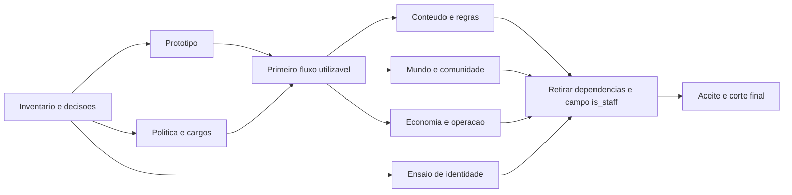

# Central de Gestao Bonfire: arquitetura de substituicao do admin

Data: 06/11/2026. Estado: execucao parcial autorizada; substituicao completa pendente.
O diagnostico inicial nao alterou acessos. A primeira fatia de Pessoas/Concessao
foi implementada em DEV apos autorizacao posterior do PO; ver
[entrega inicial](../gestao_primeira_entrega.md). Publicacao depende do lote instalado.
Nao declarar o plano inteiro concluido nem remover a identidade antiga sem o ensaio.

Leitura conjunta obrigatoria para executar este plano:
- [Auditoria ampliada do admin](20261106-auditoria-admin.md): 42 achados confirmados,
  oito verificacoes abertas, evidencias, prioridades e criterios de fechamento.
- [Inventario de destino](20261106-admin-inventario.md): todos os 75 modelos
  registrados e as ferramentas/rotas fora do registry, sem transformar cada tabela em tela.

Auditoria de 06/11: metadados locais e 26 telas/variantes publicadas em duas larguras,
apenas leitura apos login. Nao e uma implementacao nem um teste de escrita em producao.

## 1. Decisoes do PO e resultado esperado

1. Substituir a experiencia administrativa, nao apenas trocar cores do Django Admin.
2. Remover `is_staff` de fato: campo, formulario, autorizacao e dependencia funcional.
3. Preservar `is_superuser`: e a condicao de Administrador.
4. Staff, Rulesmaster, Loremaster e Jornalista sao cargos atribuiveis, com tarefas definidas.
5. Cabecalho e identidade visual coerentes com o site; navegacao interna na mesma guia.
6. Ninguem deve conhecer tabelas, PKs, codenames ou JSON interno para executar tarefas comuns.
7. Backend prioritariamente Python/Django. Reutilizar PostgreSQL, autenticacao e servicos existentes.
8. Conteudo em Markdown, mecanicas em tags e dados. Nao criar excecoes por usuario, classe ou cosmetico.

Entrega percebida pelo usuario: outro administrador consegue localizar um jogador,
ver o que ele possui e conceder um cosmetico com previa, confirmacao e historico,
sem acessar uma tela de relacionamento entre tabelas ou pedir orientacao ao Gaz.

Nao e aceite: sidebar renomeada, nova pagina inicial com atalhos para ModelAdmin,
tema comprado aplicado por cima das mesmas telas, ou todas as tarefas ainda exigindo superusuario.

## 2. Diagnostico comprovado no repositorio

| Evidencia | Local existente | Consequencia |
| --- | --- | --- |
| Admin permite apenas superusuarios | `home/admin.py`, `_admin_superuser_only`, substituicao de `admin.site.has_permission` | Cargo ou permissao editorial nao libera esse painel |
| Agrupamento continua baseado em modelos | `home/admin_navigation.py`, `grouped_admin_apps` | Agrupa tabelas, mas nao entrega processos completos |
| Header proprio, CSS proprio e nova guia | `home/templates/admin/base_site.html` | Outra experiencia; Ver Site usa `target="_blank"` |
| Entradas desktop/mobile no site tambem abrem nova guia | `home/templates/home/components/header.html` | Ida e volta acumulam abas |
| Apenas tres cargos editoriais sao criados nessa migracao | `home/migrations/0133_editorial_groups.py` | Jornalista: jornal; Staff: triagem de cronicas; Loremaster: revisao de cronicas; nao cria Rulesmaster |
| Comando paralelo concede permissoes individuais e exige booleano | `home/management/commands/assign_editorial_permissions.py` | Administracao de cargos e concessoes ficam fragmentadas |
| Permissoes de edicao exigem combinacoes diferentes | `home/views.py`, decorators e `can_edit_*` | Algumas tarefas dependem de `is_staff` mais permissao; outras so de permissao |
| Staff afeta direitos fora do painel | `home/permissions.py`, `home/badges.py` | Acesso a fichas, slots e badges podem mudar acidentalmente ao remover o campo |
| Inventario apresentado como formulario de FKs | `home/admin.py`, `TbUsuarioCosmeticoAdmin` | Exige escolher usuario, registro e origem tecnica, sem jornada de concessao |
| Suspensao do inventario nao equivale a revogar compra | `home/cosmetic_entitlements.py` | Um formulario simplificado nao pode prometer retirada de direito permanente |
| Exportador e chaves amarrados a telas/admin tecnico | `home/catalog_export_admin.py`, `home/db_access_admin.py` | E preciso separar apresentacao, autorizacao e servico, sem liberar dados indiscriminadamente |
| Usuario concreto do Django esta referenciado em muitos lugares | `home/models.py`, sinais, imports, migracoes e helpers | Remover o campo fisicamente requer migracao de identidade, nao um DROP COLUMN isolado |
| Parte do comportamento esta dentro de ModelAdmin e patches globais | `home/admin.py` | Apagar o arquivo antes de extrair servicos pode eliminar validacoes e efeitos necessarios |

Essas evidencias foram ampliadas com conferencia de leitura das telas publicadas.
Cobertura, limites e fontes estao na auditoria vinculada. Nao constituem uma auditoria
de todas as atribuicoes individuais nem de gravacoes concorrentes em producao.

A escolha anterior de restringir `/admin/` a superusuarios aparece explicitamente
no codigo. Este plano substitui a experiencia de gestao para a equipe; nao autoriza
abrir o admin antigo inteiro nem promover toda a equipe a superusuario.

## 3. Estrategia: nova aplicacao de gestao no mesmo site

Entrada proposta: `/gestao/`. Sem outro login, outro banco ou frontend separado.
Views e Forms Django renderizam HTML no servidor; JavaScript pequeno para
catalogos, drawers, previa, filtros e feedback. Sem SPA, Electron ou TS obrigatorios.

```text
Conta autenticada existente
  -> /gestao/ -> politica de capacidades + escopo do objeto
     -> consultas de leitura / formularios por tarefa
     -> servicos de dominio reutilizados
        -> transacao PostgreSQL + registro de auditoria
     -> resposta de sucesso, conflito ou negacao

Inline do site e API
  -> mesmas regras de dominio
  -> adaptadores de autorizacao proprios do canal, sem contornar restricoes
```

Reconstruir a camada de gestao; preservar o motor e os dados. Quando uma regra
esta no ModelAdmin, extrai-la antes e fazer ambos os consumidores usa-la durante
a transicao. Nao chamar uma view HTTP de dentro de outra nem duplicar o motor.

Estado final: Django Admin deixa de ser uma interface publicada de trabalho.
`/admin/` de entrada pode redirecionar para `/gestao/`; URLs antigas de objetos
so redirecionam apos autenticar e verificar a capacidade do destino.
Rotas de chaves/API/manutencao sao migradas com compatibilidade explicita,
sem redirecionar POSTs de integracao cegamente e sem alterar seus escopos.

O desligamento das telas antigas ocorre por marcos, nao por exclusao antecipada
de modelos, migracoes, logs ou regras. Nao manter um Django Admin padrao exposto
como dependencia permanente depois da remocao de `is_staff`.

## 4. Arquitetura de informacao e navegacao

Menu da conta: Gestao, visivel a Administrador ou pessoa com acesso a uma tarefa.
O mesmo criterio existe no servidor. Esconder o menu nao e controle de acesso.

| Area | Entrada e tarefas | Nao expor como navegacao principal |
| --- | --- | --- |
| Inicio | Pendencias autorizadas, ultimas acoes e tarefas frequentes | Lista de todos os modelos e relacoes |
| Pessoas e equipe | Buscar jogador, cargos, acesso efetivo, historico | Groups, User permissions e dois select-multiple gigantes |
| Aparencia e recompensas | Catalogo, inventario por jogador, conceder, suspender concessao, conquistas | TbUsuarioCosmetico e campos de origem livres |
| Regras e catalogos | Classes, subclasses, racas, magias, talentos, itens, bestiario, tags | Tabelas dependentes dispersas e IDs obrigatorios |
| Mundo e publicacoes | Regioes, territorios, organizacoes, jornal, cronicas e revisao | Campos de Markdown misturados a controles operacionais |
| Comunidade e mesas | Fogueiras, vinculos, anuncios, historico, moderacao | Misturar aprovacao de mestre com cargo da equipe |
| Economia | Consulta e conciliacao de pedidos, MM e eventos, conforme capacidade | Editar saldo sem lancamento nem justificativa |
| Operacao tecnica | API, importacao, exportacao, backups, diagnostico e manutencao | Console/segredos no header de todos os usuarios |

No maximo essas oito secoes de primeiro nivel. Itens internos aparecem conforme
capacidade. Contagens incluem apenas filas que a pessoa pode consultar.
Busca global retorna tarefas e entidades por nome, com area e contexto, nao uma
lista de nomes de tabelas. Busca de pessoas aceita usuario, nome publico e Discord;
email apenas para quem possui capacidade especifica de consultar esse dado.

Esqueleto de tela, nao mockup estetico aprovado:

```text
[marca/cabecalho compartilhado do site]       [voltar ao site] [conta]
[navegacao de gestao] | Aparencia > Inventario > Jogador
                     | Jogador / Discord / conta confirmada
                     | [Cosmeticos] [Conquistas] [Historico]
                     | Busca e filtros                  [Conceder]
                     | Miniatura | Nome | Origem | Estado | Acoes
```

## 5. Cargos e permissoes: uma fonte de verdade

### 5.1 Modelo de autoridade

- Administrador = usuario ativo com `is_superuser=True`. Sem Group Administrador
  paralelo fingindo ser a mesma coisa. A UI apresenta o nome do cargo.
- Staff, Rulesmaster, Loremaster e Jornalista = Groups de `auth`, com Permissions.
- Uma pessoa pode acumular cargos. Permissoes efetivas sao a uniao das concessoes
  autorizadas, sujeita a escopo, estado da conta e travas de operacoes sensiveis.
- Nao criar `is_rulesmaster`, `is_loremaster`, outro booleano Staff ou permissao
  baseada em username/Discord especifico.
- Cargos publicos/badges, mestre aprovado, rank e colaboracao nao conferem acesso
  administrativo por si so. A exibicao usa os mesmos cargos, nao uma tabela paralela.
- `is_active` permanece: conta inativa nao ganha acesso nem se for Administrador.

### 5.2 Capacidades orientadas a acao

Exemplos de contratos, nao permissao ja instalada:

| Capacidade | Operacao |
| --- | --- |
| `gestao.access` | Entrar no painel com ao menos uma tarefa autorizada |
| `cosmeticos.view_catalog` / `view_inventory` | Consultar catalogo e inventario |
| `cosmeticos.grant_manual` / `retract_manual` | Conceder e retirar somente fonte manual |
| `regras.edit` / `regras.publish` | Editar dados e publicar regras, separadamente |
| `tags.edit_definition` / `tags.publish_definition` | Alterar contrato generico de tags |
| `mundo.edit` / `mundo.publish` | Conteudo e publicacao de mundo |
| `cronicas.triage` / `cronicas.review` | Triagem e decisao editorial |
| `pessoas.view_private` / `equipe.manage_roles` | Dados privados e gestao de cargos |
| `mestres.manage_roster` | Vincular Fogueira existente, sem fabricar identidade |
| `economia.reconcile` | Conciliar com prova, sem editar recibo pago |
| `export.catalog` | Exportar apenas catalogos permitidos |

Nomes amigaveis na UI; mapeamento explicito para Permissions existentes ou novas
no backend. As Permissions reais usam o contrato app_label.codename do Django.
O registro de tarefas aponta para capacidades, rotas e consultas; nao permite
injetar Python, SQL ou expressao executavel pelo banco.

Uma politica central propoe `can(actor, capability, obj=None)` e um guard de view.
O mesmo criterio e usado no GET, POST, inline, queryset, exportador e navegador.
As regras proprias da chave da API continuam adicionais: nao herdar acesso do
painel para uma chave nem permitir que cargo crie escopo novo silenciosamente.

### 5.3 Matriz inicial proposta para aprovacao

A = Administrador. S = Staff. R = Rulesmaster. L = Loremaster. J = Jornalista.
Esta matriz e proposta; nao promover contas nem ampliar permissao em producao
antes de aprovar as atribuicoes e seus efeitos.

| Tarefa | A | S | R | L | J |
| --- | --- | --- | --- | --- | --- |
| Entrar e ver tarefas do proprio cargo | Sim | Sim | Sim | Sim | Sim |
| Conceder cosmetico manual ja publicado | Sim | Proposto | Nao | Nao | Nao |
| Criar/reclassificar cosmetico, evento e oferta | Sim | Nao | Nao | Nao | Nao |
| Editar regras, catalogo e tags | Sim | Nao | Proposto | Nao | Nao |
| Publicar revisao de regras | Sim | Nao | Decidir | Nao | Nao |
| Editar/publicar mundo e decidir cronicas | Sim | Nao | Nao | Proposto | Nao |
| Triar denuncias/cronicas | Sim | Proposto | Nao | Proposto | Nao |
| Criar/editar jornal | Sim | Nao | Nao | Nao | Proposto |
| Vincular Fogueira / aprovar trabalho de mestre | Sim | Decidir | Nao | Nao | Nao |
| Exportar catalogo da propria area | Sim | Nao | Proposto | Proposto | Nao |
| Conciliacao financeira, dados privados, cargos | Sim | Nao | Nao | Nao | Nao |
| Chaves amplas, backup completo, restore, console | Sim | Nao | Nao | Nao | Nao |

Operacoes de superusuario e fonte paga nunca sao liberadas por uma soma de
permissoes editoriais. Elevacao/rebaixamento de Administrador exige outro
Administrador autorizado, autenticacao recente, motivo e auditoria; impedir
remover o ultimo Administrador ativo. Nao permitir autopromocao.

### 5.4 Interface de cargos e excecoes

Pessoa > Acesso: cargos selecionaveis com nome, resumo e lista de acoes em PT-BR.
Mostrar por que a pessoa possui cada permissao e o que muda antes de salvar.
Salvar atomicamente, exigir versao esperada e registrar autor/motivo/diferenca.
Uma tentativa com tela antiga revalida permissao no servidor antes de gravar.

Permissoes individuais existentes devem aparecer no diagnostico como excecoes,
nao sumir ao salvar cargos. Nao copiar automaticamente toda excecao para um cargo.
Na primeira entrega, novas excecoes individuais ficam fora do fluxo comum;
o Administrador pode revisar as antigas em detalhe. Se forem necessarias novas
excecoes, implementar fluxo delimitado e auditado, nao o widget bruto do Django.

## 6. Remocao efetiva de is_staff

### 6.1 Estado final obrigatorio

- Nenhuma coluna `is_staff` no modelo de conta nem no banco final.
- Nenhuma propriedade de compatibilidade `is_staff = is_superuser` como solucao final.
- Nenhuma view, template, badge, fixture atual ou backend depende de `is_staff`.
- `is_superuser`, `is_active`, Groups, Permissions e os vinculos existentes permanecem.
- Staff e cargo, nao alias do antigo booleano. Conceder cargo nao muda flags tecnicas.

O `auth.User` padrao e `AbstractUser` incluem `is_staff`. A proposta e um usuario
concreto em app dedicado, por exemplo `accounts.User`, baseado em
`AbstractBaseUser` + `PermissionsMixin`, sem herdar `AbstractUser`.
Manager, formularios e campo de login precisam preservar o comportamento atual.
Adotar `settings.AUTH_USER_MODEL` nos relacionamentos e sinais; `get_user_model()`
no codigo de execucao. Nao colocar o novo usuario numa migracao tardia de home:
ele precisa nascer na primeira migracao da nova app para o grafo dinamico do Django.

### 6.2 Migracao de identidade: marco tecnico separado

1. Inventariar todos os imports, FKs, M2Ms, sinais, codenames, fixtures, serializers,
   tarefas do bot/API, testes e dependencias de `auth.User` e do booleano.
2. Fotografar integridade, sem expor dados: PKs, donos, hashes de senha, Discord,
   carteiras, pedidos, cargos e permissoes. Produzir backup verificavel e ensaiar restore.
3. Gerar proposta de equivalencia dos acessos atuais por usuario. Regras antigas
   que usam `is_staff` nao viram privilegio universal por conversao automatica.
   PO aprova discrepancias de cargos e beneficios antes da retirada do campo.
4. Extrair/adaptar primeiro guardas, Forms, sinais e endpoints; nenhuma alteracao
   cosmetica deve depender de uma promovida geral de usuarios.
5. Projetar e ensaiar a adocao da tabela fisica `auth_user` pelo novo modelo, com
   as mesmas PKs, hashes e sequencias. Preservar tambem as tabelas M2M existentes
   de grupos e permissoes. Nao criar usuarios novos para copiar os antigos.
6. Validar o grafo de migracoes, dependencias swappable, content types e permissoes
   de conta. Historico de LogEntry e auditoria deve continuar legivel; codenames
   antigos nao podem passar a autorizar uma operacao diferente por colisao.
7. Ensaiar tanto upgrade da copia da producao quanto instalacao em banco vazio.
   Uma migracao de adocao de tabela nao pode tornar instalacoes novas impossiveis.
8. Desacoplar as telas tecnicas do Django Admin padrao: login admin, UserAdmin,
   `staff_member_required`, each_context, autodiscovery e includes devem ser revistos.
   Manter tabelas historicas do admin nao significa manter seu frontend publicado.
9. Aplicar a troca numa janela controlada, sem escritores com codigo antigo.
   Validar o modelo novo e so depois retirar a coluna, sem DROP avulso ou `--fake`.
10. Comparar invariantes e testar login senha, OAuth Discord novo/existente/vinculo,
    recuperacao de senha, API, criacao de conta e acesso das funcoes da equipe.

O desenho preciso de migracoes estado/banco depende do ensaio. Este documento
nao e um roteiro de SQL pronto para executar na producao. Nao reescrever a
migration historica de limpeza de emails para que deixe de reproduzir o passado;
adequar backup/import e replay conforme o estado historico do modelo.

Inventario de efeitos colaterais obrigatorios: slots ilimitados, leitura de ficha
privada, mestre aprovado, badges da equipe, moderacao, descontos e demais usos do
helper `is_staff_user`. Substituir por capacidades de cada dominio, nao renomear
esse helper para um novo teste generico que concede tudo a qualquer cargo.

Rollback: antes da troca, manter ultima versao implantavel e backup restauravel.
Depois de remover coluna/modelo antigo, codigo antigo nao pode ser apenas ligado
de novo; exigir reversao ensaiada ou restauracao coordenada. Validar a janela
sem escritas para nao perder novas contas ou transacoes por restaurar snapshot.

## 7. Fluxos completos que substituem formularios de tabela

### 7.1 Conceder cosmetico: primeira fatia vertical

1. Aparencia > Jogadores, ou Pessoas > jogador > Aparencia.
2. Buscar pessoa e mostrar identificacao inequivoca por conta e Discord, quando permitido.
3. Abrir catalogo por miniaturas: tipo, nome, estado, origem e previa de um item por vez.
4. Selecionar um ou mais itens, ver se ja possui e informar motivo da concessao.
5. Previa com beneficiario, itens novos, ja possuidos e restricoes. Cancelar nao grava.
6. Confirmar; o servidor revalida capacidade, versao e catalogo, aplica idempotentemente.
7. Mostrar concedidos/ja existentes e abrir o inventario ou historico sem mudar de guia.

Nao editar `origem` como string livre; o servidor registra fonte manual e autor.
Nao sobrescrever fonte de compra, conquista ou evento. Uma compra ja existente
nao vira manual so porque o admin tentou conceder o mesmo item.
Retirar uma concessao manual nao remove um direito adquirido por outra fonte.
Direito pago exige fluxo proprio de conciliacao; estorno nao e DELETE de inventario.
Reativar item suspenso deve ser acao explicita, nao efeito colateral de conceder.

Como o inventario atual so tem uma linha por usuario/cosmetico e uma string de
origem, levantar a necessidade de evidencias de concessao por fonte. Se necessaria,
criar registro manual separado, auditavel e idempotente, integrado ao resolvedor
existente de direitos. Nao fingir multiorigem alterando a string da linha atual.
Esse ponto precisa ser fechado no desenho do servico antes do aceite de retirada.

Lotes: limite, previa, chave idempotente, recibo por resultado e resultado parcial
explicito quando o processo for dividido. Nao usar uma transacao gigante para todos.
Mudanca de disponibilidade do item invalida a previa. Preview de item bloqueado
nao concede seu uso nem remove restricoes de teste/admin-only.

### 7.2 Pessoas e acesso

Uma ficha operacional de pessoa com abas: resumo, cargos/acesso, personagens,
cosmeticos e historico. Emails e dados de pagamento ficam restritos. Nao misturar
editar senha, promover Administrador e conceder item no mesmo formulario.
Sem botao de excluir conta no caminho comum; inativacao e exclusao sao processos
distintos e revisam personagens, compras, historico e responsabilidade por registros.

### 7.3 Conteudo, tags e publicacao

Lista legivel > detalhe > editar > validar > previa > salvar/publicar conforme dominio.
Reutilizar editor Markdown e biblioteca de tags, com nomes amigaveis e referencias.
Formularios estruturados para mecanicas ja conhecidas; JSON avancado so em aba
tecnica autorizada. Nunca cadastrar regra como Python por comodidade de interface.
Validacao da tag nao significa que existe consumidor funcional: mostrar suporte.

Preservar a distincao entre catalogo vivo, revisao selada e publicacao efetiva.
Mostrar qual versao esta em uso, diferencas e impacto antes de publicar; nao
substituir revisao imutavel nem migrar personagens legados silenciosamente.
Nao inventar fluxo de rascunho universal onde o dominio ainda nao o suporta:
definir por recurso se Salvar altera ao vivo ou se cria proposta/revisao.

### 7.4 Economia, Fogueiras e operacao

Consulta de saldo e pedidos e diferente de emitir credito, estornar ou cobrar.
Toda mutacao financeira usa o ledger existente e preserva idempotencia e provas.
Fogueira e identidade de mestre sao independentes de cargo da equipe; reivindicacao
por Discord continua validada via OAuth e nao por texto digitado no painel.
Restauracao completa exige preview, backup, verificacao de identidade e confirmacao
forte. Exportacao de catalogo nao inclui hashes, tokens, dados privados ou backup.
Console, segredos, restore e chaves amplas permanecem exclusivos de Administrador.

## 8. UI: regras que impedem repetir a tela antiga

- Compartilhar marca, fontes, tokens, menu da conta e componente de header do site,
  com variante de contexto de gestao; nao copiar outro header com estilos inline.
- Layout utilitario: area de trabalho ampla, navegacao curta e titulo compacto.
  Sem hero de boas-vindas, cards dentro de cards ou espacos decorativos gigantes.
- Uma pagina de entidade tem nome, contexto, estado, acoes principais e abas coerentes.
- Listas mostram nome humano, miniatura quando util, estado, origem e data relevante.
  IDs sao copiaveis em detalhes tecnicos, nao o identificador exigido para trabalhar.
- Ordenacao, filtros e pagina em query string; voltar do detalhe restaura a busca.
  Paginacao fora da grade, rotulada, com limites desabilitados e topo dos resultados.
- Foreign keys viram busca/autocomplete com contexto. Nunca despejar todos os usuarios
  e itens num dropdown nem usar o seletor duplo de permissoes do Django.
- Catalogos de cosmeticos usam thumbnails lazy; previa animada apenas do selecionado.
- Campos e erros em PT-BR; labels por dominio. Datas em America/Sao_Paulo, com fuso
  identificado quando relevante; nao apresentar aviso de diferenca UTC como erro do usuario.
- Comandos com texto claro; icones existentes da biblioteca com tooltip nos atalhos.
  Toggles para estado binario, inputs/stepper para quantidade, abas para subareas.
- Formulario longo agrupado por assunto; sem barra fixa sobrepondo campos.
  Se houver barra de acoes fixa, reservar seu espaco e testar teclado/zoom/mobile.
- Salvar mostra sucesso ou erro contextual. Conflito nao perde a edicao.
  Sem permissao, vazio, carregando, falha de rede e nenhum resultado sao estados distintos.
- Links internos seguem na mesma guia. Ctrl/clique do meio fica por conta do navegador.
  Preview externo pode abrir outra guia somente quando explicitamente indicado.
- Mesmas tarefas nao ganham layouts diferentes por recurso. Componentes compartilhados
  para tabela, paginacao, busca de entidade, editor, previa e confirmacao.
- Respeitar teclado, foco visivel, leitores de tela, zoom 200%, contraste e reducao
  de movimento. Testar larguras 390/768/1440 e nomes compridos.
- O novo CSS nao depende de `admin/base.html`, `.submit-row` ou patches globais.

## 9. Seguranca, concorrencia e auditoria

Toda acao de escrita: POST com CSRF, sessao ativa, capacidade verificada novamente,
escopo do alvo, allowlist de campos e validacao do servico. Permissao e reavaliada
apos adquirir os bloqueios de escrita pertinentes; preview nao e autorizacao permanente.
Querysets filtrados antes de paginar e contar. Busca nao vaza emails, objetos nem pendencias.

Auditoria de gestao: ator, tarefa, entidade/PK, instante, motivo, resultado,
versao de origem/destino e request/idempotency ID. Diferencas somente de campos
permitidos; nao registrar senha, hash de senha, token, segredo, cookie ou corpo HTTP inteiro.
Ledger e recibos existentes continuam fontes de verdade; a auditoria referencia
essas provas, nao cria um segundo sistema de credito ou publicacao.
Historicos sao de leitura para operadores. Reversao e outra acao auditada,
nao edicao retroativa do recibo. Falha na auditoria obrigatoria impede o commit da mutacao.

Acao sensivel exige autenticacao recente e resumo do impacto. Proteger a ultima
conta Administradora e negar elevacao de privilegio pelo formulario, API ou inline.
Aplicar `Cache-Control: no-store` para dados pessoais e operacoes de acesso.
Nenhuma alteracao de grupo pode ampliar a chave Bonfire de producao por heranca.

## 10. Organizacao proposta dos arquivos

Estes caminhos novos sao proposta, nao arquivos ja existentes:

```text
accounts/
  models.py, managers.py, forms.py, apps.py
  migrations/0001_initial.py   # grafo/adocao a desenhar no ensaio
home/gestao/
  urls.py                    # namespace proprio
  policy.py, roles.py        # capacidades e cargos; sem regra por usuario
  navigation.py              # tarefas, rotas, titulos e capacidades
  audit.py                   # integra prova das acoes
  forms/                     # pessoas, acesso, concessoes e editores
  queries/                   # leituras por area, escopo e paginacao
  services/                  # comandos de gestao sobre dominios existentes
  views/                     # adaptadores HTTP curtos por area
home/templates/home/gestao/
  shell.html, inicio.html, pessoas/, aparencia/, conteudo/, operacao/
home/templates/home/components/
  # tabelas, paginacao, busca e confirmacoes reutilizaveis
home/static/css/pages/gestao.css
home/static/js/gestao/
```

Nao criar CRUD universal por introspeccao com acesso a todos os modelos.
Os editores compartilham infraestrutura, mas usam campos/acoes explicitamente
permitidos por recurso. Logs, recibos, compras e snapshots nao sao formularios CRUD.

| Arquivo existente | Tipo de trabalho planejado |
| --- | --- |
| `bonfire/settings.py` | Instalar app de conta, AUTH_USER_MODEL e rollout; nao usar .env como cadastro de cargos |
| `bonfire/urls.py`, `home/urls.py` | Rotas gestao, compatibilidade e retirada coordenada da entrada antiga |
| `home/models.py` | FKs/sinais swappable e eventuais evidencias de concessao/auditoria; preservar tabelas/PKs |
| `home/apps.py` | Revisar boot, registros e dependencia de autodiscovery/admin |
| `home/views.py` | Trocar guards e imports; extrair somente trechos dos dominios migrados |
| `home/permissions.py`, `home/badges.py` | Desmembrar efeitos de is_staff em capacidades explicitas |
| `home/admin.py` | Inventariar acoes/validacoes; extrair servicos; retirar patches e UI so apos cobertura |
| `home/admin_navigation.py` | Apos substituicao, retirar mapa de modelos como navegacao operacional |
| `home/templates/admin/`, `home/static/css/admin/` | Retirar interface antiga por area; nao copiar como nova central |
| `home/templates/home/components/header.html`, `home/templates/home/base.html` | Header compartilhado, entrada Gestao e navegacao mesma guia |
| `home/migrations/0133_editorial_groups.py` | Referencia historica; nao reescrever para resetar cargos existentes |
| `home/management/commands/assign_editorial_permissions.py` | Substituir caminho paralelo por politica/servico; preview de conversao antes de aposentar |
| `home/management/commands/ensure_admin_user.py` | Recuperacao do Administrador sem is_staff; adaptar criacao/manager, nunca executar reset de senha por migracao |
| `home/email_identity.py`, `home/email_identity_admin.py`, `home/email_cleanup_v1.py` | Preservar unicidade normalizada; trocar forms atuais sem corromper replay historico |
| `home/cosmetics.py`, `home/cosmetic_entitlements.py` | Resolvedor de direitos, cache, fonte manual e permanencia comprada |
| `home/conquistas.py`, `home/rank_cosmetic_rewards.py`, `home/event_cosmetics.py` | Reutilizar concessoes e recibos, sem segunda implementacao de recompensa |
| `home/cosmetic_reclassification.py` | Preservar protecoes de oferta, selecao e conflito de categoria |
| `home/class_revision_editor.py`, `home/class_publication.py`, `home/content_versions.py` | Reutilizar revisao/publicacao; nao editar snapshots pelo CRUD |
| `home/master_participation.py`, `home/master_portfolio.py`, `home/master_hub.py` | Usar politica central nas tarefas sem alterar criterio de identidade de mestre |
| `home/master_legacy.py`, `home/master_legacy_admin.py` | FKs/adaptadores; conservar reconciliacao, autor e idempotencia |
| `home/profile_comments.py`, `home/profile_comments_admin.py` | Moderacao por tarefa e escopo, com fontes de auditoria existentes |
| `home/catalog_export.py`, `home/catalog_export_admin.py` | Reaproveitar exportador e tickets; mover UI e limitar por capacidade/colunas |
| `home/db_access.py`, `home/db_access_models.py`, `home/db_access_admin.py` | Identidade swappable; nao expandir os escopos sensiveis das chaves |
| `home/templates/admin/base_site.html`, `home/templates/home/components/header.html` | Remover nova guia interna durante o corte; preservar links externos apropriados |

## 11. Inventario de cobertura: nenhum modulo esquecido

Antes de iniciar o corte, gerar uma matriz controlada com uma linha por recurso
atualmente registrado no admin e por acao customizada:

`recurso | tarefas reais | usuarios/cargo | leitura | escrita | efeitos | sensibilidade | servico | tela nova | destino antigo | estado | evidencia`

Valores de estado: inventariado, projeto aprovado, implementado, validado pelo
operador, publicado, antigo retirado. Uma pagina inicial pronta nao conclui uma area.
Todo modelo deve ter destino justificado: tela de tarefa, consulta tecnica somente
leitura, processamento interno ou obsoleto comprovado. Nao gerar 92 telas identicas.
A contagem exata deve vir do registry e rotas atuais, nao do numero no print.

O inventario inicial foi realizado: 75 modelos, sete deles do bot sem gerenciamento
de migrations. Os 92 atalhos do painel nao sao 92 modelos. O documento de destino
ja enumera os 75 e os fluxos fora do registry; durante P0, complementar capacidade,
efeitos, responsavel e prova por tarefa. Nao repetir a coleta inteira sem mudanca relevante.
Consultar ADM-01 a ADM-42 e R-01 a R-08 para nao esquecer operacao, recibos,
concorrencia, importadores ou efeitos de identidade ao redesenhar a interface.

## 12. Sequencia finita de execucao

| Etapa | Entrega fechada | Dependencia | Esforco indicativo |
| --- | --- | --- | --- |
| P0 | Fechar efeitos/capacidades a partir do inventario e auditoria ja produzidos | Plano aprovado | 4-8 h |
| P1 | Prototipo navegavel de Inicio, Pessoa/Acesso, Catalogo e Conceder | P0 | 6-10 h |
| P2 | Politica central, cargos e comandos auditados; migracao simulada de acessos | P0 e matriz aprovada | 10-18 h |
| P3 | Shell real + Pessoas/Aparencia ponta a ponta em DEV | P1 + P2 | 10-18 h |
| P4 | Conteudo, mundo, comunidade, economia e operacao; migracao por recurso | P2; shell P3 compartilhado | 24-44 h |
| P5 | Usuario proprio, adaptacoes de identidade, replay/upgrade e retirada de is_staff | P0 + politica e todos os consumidores adaptados | 20-40 h |
| P6 | Aceite integrado, publicacao, conferencia e retirada das telas antigas | P3-P5 completos | 6-12 h |

Ordem logica: politica e prototipo antes de refazer formularios. P5 comeca pela
investigacao em paralelo a P1/P2, mas a troca de identidade nao vai a producao
antes de os consumidores estarem prontos. P3 pode ser demonstrado antes de P5;
isso e aceite parcial e nao comprova a remocao fisica de `is_staff`.



Estimativa total: aproximadamente 80-150 horas de engenharia, incluindo a troca
de usuario e uma rodada de ajuste por aceite. E ordem de grandeza, nao prazo
garantido nem estimativa de tokens. O inventario pode revelar integracoes adicionais.
Prototipo de navegacao: cerca de 1-2 dias. Primeira demonstracao funcional com cargos
e concessao: cerca de 4-7 dias de trabalho de uma pessoa;
substituicao completa: aproximadamente 2-4 semanas de uma pessoa em dedicacao integral,
sem contar esperas de aprovacao. Paralelismo reduz prazo, nao soma de esforco.

Paralelizar somente depois dos contratos: conteudo, mundo/comunidade e economia
podem ser frentes independentes. Um responsavel integra policy, conta, urls, shell
e modelos compartilhados. Usar branches/worktrees e base estabilizada; nenhum
agente altera ao mesmo tempo o schema de conta, saldos ou deploy de producao.

Nao pedir confirmacao a cada formulario. Pedir aprovacao por marco e somente por
mudanca real de politica, acesso ou dado. Registrar bloqueio especifico e executar
as frentes independentes; nao reiniciar uma meta grande com contexto acumulado.

Requisitos do levantamento nao viram 42 remendos independentes no admin velho.
Primeiro comprovar o fluxo Pessoa -> Inventario -> Conceder; depois ampliar os
dominios no mesmo padrao. Economia/bot/recibos recebem comandos de dominio,
nao novos ModelForms de saldo ou status. Backup e restore recebem contrato
verificavel; acoes globais mostram seu escopo antes da confirmacao.

## 13. Aceite verificavel e testes proporcionais ao risco

### Produto: primeira demonstracao

- Uma pessoa da equipe que nao seja o Gaz encontra um jogador e concede um item
  sem instrucao externa; alvo de ate 2 minutos apos entrar no painel.
- Consegue identificar ja possuido, origem da concessao e quem concedeu.
- Consegue trocar um cargo e explicar o acesso resultante pela propria tela.
- Rulesmaster e Loremaster encontram suas tarefas sem acesso financeiro ou tecnico.
- Entrar, voltar ao site, voltar a lista e cancelar nao abrem guias nem perdem filtros.
- Reprovacao do prototipo volta a P1; nao reconstruir todas as areas sobre UI reprovada.

### Seguranca e dominio

- Matriz pequena e gerada de ator x acao x objeto, com positivo e negativo por capacidade.
- Conta inativa, cargo retirado em outra aba, POST direto e queryset fora de escopo negados.
- Cargo nao promove Administrador; ultimo Administrador nao pode ser removido.
- Duplo clique/retry nao duplica item, premio ou credito; item pago nao perde direito.
- Conflito de versao nao sobrescreve o trabalho alheio; erro nao informa sucesso.
- Conteudo editado, revisao selada e publicacao efetiva conferidos separadamente.
- Login, OAuth, senha, unicidade de email e propriedade de fichas conferidos no ensaio de conta.
- Base vazia e clone protegido da producao migram; contagens/vinculos e hashes preservados.
- Nenhum acesso operacional ou atributo atual depende de `is_staff` no corte final.

### Interface

- Desktop 1440, tablet 768, celular 390 e zoom 200%; foco, rotulos, contraste e teclado.
- Header compartilhado, sem mixed English, sem campos cobertos e sem scroll horizontal global.
- Tabelas largas tem rolagem local; acao principal e erro seguem visiveis/acessiveis.
- Previa de um item nao carrega todas as animacoes nem trava a pagina.

### Achados da auditoria ampliada

- Cobertura por destino dos 75 modelos e das rotas fora do registry, nao apenas paginas iniciais.
- Busca de entidade real; cancelar restaura filtros; PT-BR e fuso corretos sem regravar timestamps.
- Ledger, comprovantes pagos, revisoes e tabelas do bot nao oferecem CRUD irrestrito.
- Concessao/retracao mostra fonte e direito efetivo; compra permanente nao e removida por engano.
- Importacao usa plano assinado/ator/validade/conflito; nao confiar somente em payload hidden.
- Lote explicita escopo real e trabalho longo tem estado consultavel, sem retry cego.
- Backup nao se declara completo omitindo erro; restore exige previa e backup verificado.
- Auditoria identifica operador sem registrar segredo; biblioteca e API preservam seus controles.
- Nenhuma tela precisa das centenas de Permissions ou de todos os inlines para uma tarefa simples.

Testes focados por area durante implementacao. Reutilizar as evidencias intactas;
uma verificacao integrada no marco e a regressao ampliada de autenticacao na troca
de usuario. Nao executar suite geral a cada ajuste visual. A ausencia de testes
de autorizacao nao e uma economia aceitavel nesta mudanca transversal.

## 14. Implantacao e criterio de encerramento

Preview/DEV primeiro. Aprovar a navegacao e o fluxo de concessao com operadores reais.
Preparar lote de codigo + migracoes + plano de equivalencia de acessos + rollback.
Primeiras etapas podem usar acesso restrito por usuario/capacidade para validacao,
sem alterar a rota padrao de todos imediatamente.
Publicacao continua pelo fluxo monitorado do BonfireBot; push nao e deploy.
A mudanca de usuario/coluna exige que esse fluxo suporte a janela ensaiada e as
dependencias de configuracao. Se nao suportar, adaptar o fluxo antes, nao pedir
DROP manual ao PO durante uma falha de `/site-update`.

Concluir somente quando:

1. Todas as areas do inventario tem destino aceito e as tarefas comuns nao redirecionam a ModelAdmin.
2. Staff/Rulesmaster/Loremaster/Jornalista funcionam com cargos reais e politica central.
3. Administrador continua baseado em `is_superuser`, e a remocao de `is_staff` e comprovada no banco/modelo.
4. Contas, personagens, grupos, vinculos, senhas, saldos, compras e recibos foram preservados.
5. Operadores nao tecnicos completaram os fluxos criticos sem ajuda do desenvolvedor.
6. Codigo e dados estao publicados/conferidos, e a antiga experiencia foi retirada.

## 15. Decisoes que faltam antes da implementacao

- Aprovar a matriz de tarefas, especialmente concessao manual por Staff, publicacao
  de regras por Rulesmaster e aprovacao/vinculo de mestres por Staff.
- Nomear as contas de cada cargo. Nenhum nome dos prints significa promocao automatica.
- Aprovar o prototipo de quatro telas antes de replicar o padrao.
- Confirmar a janela para a migracao de identidade apos o ensaio mostrar duracao e rollback.

As decisoes de remover `is_staff`, manter `is_superuser`, nao abrir abas internas
e abandonar o ModelAdmin como experiencia da equipe ja foram dadas; nao perguntar de novo.

## 16. Referencias e limites do planejamento

- Django 6.0.4 consta em `requirements.txt`; nao implica confirmar a versao atual do servidor.
- https://docs.djangoproject.com/en/6.0/ref/contrib/admin/
  A documentacao distingue interface por modelos de interface por processos.
- https://docs.djangoproject.com/en/6.0/topics/auth/default/
  Groups/Permissions e os atributos especiais de usuario sao mecanismos distintos.
- https://docs.djangoproject.com/en/6.0/topics/auth/customizing/
  Trocar AUTH_USER_MODEL no meio do projeto afeta FKs, M2Ms e o grafo de migracoes.

Este documento nao afirma que a nova central esta pronta, que usuarios receberam
cargos novos ou que a autenticacao foi migrada. Estimativas e nomes de modulos novos
sao proposta de execucao; a lista de evidencias identifica o que existe atualmente.
